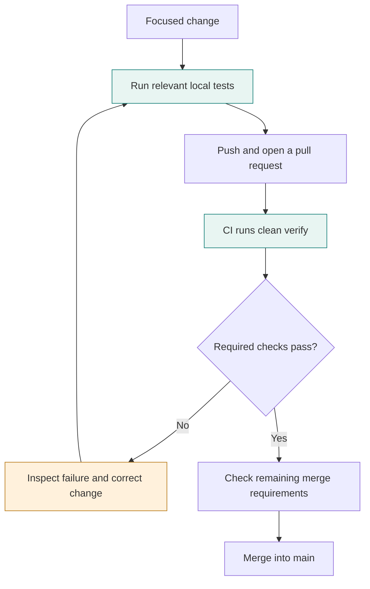

# How Continuous Integration Protects Main

**Goal:** distinguish tests, a CI workflow and merge protection.

**Prerequisites:** basic Git commits and pull requests. **Reading time:** about 8 minutes.

## Three mechanisms work together

A test encodes an expectation. The CI workflow runs those expectations for a proposed change. A repository ruleset decides which results must be present before the change can merge.



A green check is necessary when required by the ruleset, but other conditions can still prevent merging: conflicts, branch freshness or required approvals, for example.

## Why the domain tests run first

The Maven reactor orders modules by their dependencies. HexaStock has seven child modules: `domain`, `application`, four adapter modules and `bootstrap`, plus the parent POM.

Domain tests need no database. The default build stops at a failing module, so an arithmetic regression can be detected before later modules start database containers. A defect in a later integration boundary requires the preceding modules to build first.

Timings depend on dependencies, image downloads, runners and workload. Earlier successful full runs took about two minutes; treat that as an observation, not a guaranteed duration.

The workflow triggers on pushes to `main` and pull requests targeting `main`. It does not run for every arbitrary branch push before a pull request exists.

## What the ruleset adds

The main-branch rules require changes to arrive through pull requests and require `build-and-test`. They also prevent deletion and non-fast-forward updates. These are repository settings, not behaviors encoded by Maven.

A pull request can be textually mergeable while blocked by required checks. Conversely, a passing build does not resolve a textual conflict. Inspect both kinds of status.

See [CI configuration](CI_SETUP.md) for the current workflow, report-path limitations and the command for inspecting active rules.

## Historical evidence

[PR #30](https://github.com/alfredorueda/HexaStock/pull/30) recorded a deliberate regression: omitting the cash deduction in `Portfolio.buy`. Its reported run had three failing domain tests and was blocked; the PR was closed without merging.

[PR #31](https://github.com/alfredorueda/HexaStock/pull/31) delivered the original CI walkthrough through a passing pull request. These are records of those revisions and settings, not a substitute for inspecting today's active configuration.

To observe the mechanism yourself, use the [demonstration script](CI_DEMO_SCRIPT.md) in a personal fork.

## Passing tests still need review

A test suite can pass after an assertion is weakened or a case is removed. Reviewers should compare changed requirements, implementation and assertions. Coverage shows executed lines; it does not show whether the assertions are meaningful.

Possible additional controls include required reviews, CODEOWNERS for sensitive paths and mutation testing. These are distinct configuration or tooling choices, not all existing guarantees of this repository. A CODEOWNERS file alone does not require approval unless the corresponding protection rule is enabled.

SonarCloud checks may appear through a connected service. The checked-in CI workflow does not itself run a scanner or enforce a Sonar quality gate. See [the configuration reference](CI_SETUP.md) before making coverage or merge-gate claims.

## Recover from a rejected direct push

A rejected push leaves local commits intact. If you accidentally committed on local `main`, preserve the work on a contribution branch:

```bash
git switch -c docs/my-change
git push -u origin docs/my-change
```

Then open a pull request against `main`. There is no need to discard the work with `git reset --hard`. Check for uncommitted changes before any later branch cleanup.

## Checkpoint

Why does “the code compiles” not mean “the change can merge”?

**Answer:** compilation is only one build step. Tests, required status checks and repository rules add independent conditions. None of them removes the need to review whether the behavior is correct.

For smaller examples, see [ci-demo-python](https://github.com/alfredorueda/ci-demo-python) and [ci-demo-java](https://github.com/alfredorueda/ci-demo-java). They introduce the same mechanism with smaller test suites.
