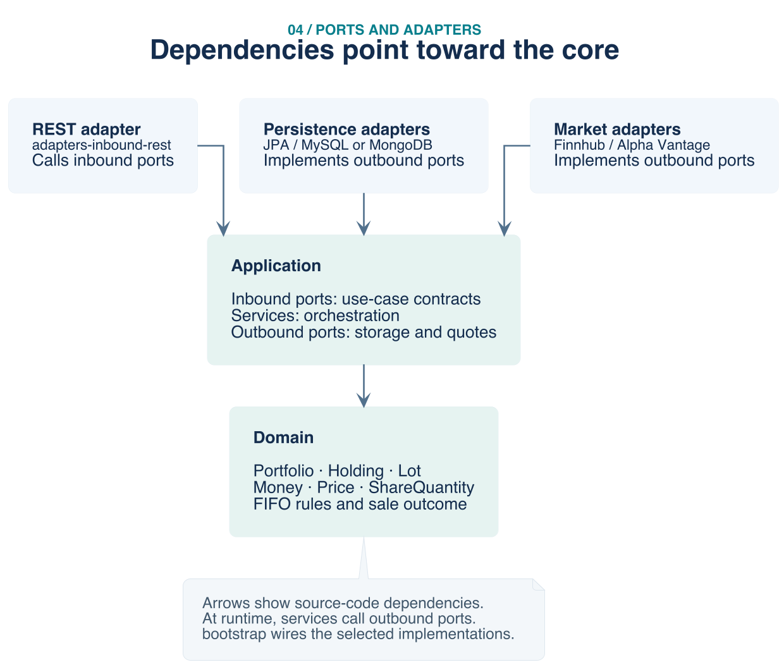

# Architecture map: follow the dependencies

**Prerequisite:** understand a portfolio, holding and purchase lot from [the vocabulary](../tutorial/sellStocks/UBIQUITOUS-LANGUAGE.md). **Outcome:** identify which module owns each responsibility in a sale.

## Seven modules, four kinds of responsibility

A Maven module is a separately compiled part of this repository. A port is a Java interface describing an interaction; an adapter implements or invokes that interface using a particular technology.

| Module | Responsibility | Production dependencies of interest |
|---|---|---|
| `domain` | Business types, rules and calculations | JDK; no Spring or persistence framework |
| `application` | Use-case coordination and port interfaces | Domain and Jakarta Transactions |
| `adapters-inbound-rest` | HTTP controllers, DTOs and error mapping | Application, Spring MVC, SpringDoc |
| `adapters-outbound-persistence-jpa` | MySQL persistence and mappings | Application, Spring Data JPA, Hibernate |
| `adapters-outbound-persistence-mongodb` | Document persistence and mappings | Application, Spring Data MongoDB |
| `adapters-outbound-market` | Quote providers and adapter caching | Application, HTTP client and cache libraries |
| `bootstrap` | Entry point, profiles, wiring and integration tests | The six other modules |

The parent POM is an eighth POM, not an eighth child module. Test dependencies are scoped separately: the domain inherits the parent's test starter, although domain production code is framework-free.

[Open the scalable dependency map](https://raw.githubusercontent.com/alfredorueda/HexaStock/main/doc/tutorial/sellStocks/diagrams/Rendered/sell-architecture-overview.svg)

The [original hand-drawn hexagon and its explanation](../tutorial/sellStocks/SELL-STOCK-04-HTTP-AND-PORTS.md) provide another view of the same boundary. Read arrows according to each diagram's legend: runtime calls and source-code dependencies are different relations.

## Ports name conversations

| Input port | Use case |
|---|---|
| `PortfolioLifecycleUseCase` | Create, retrieve and list portfolios |
| `CashManagementUseCase` | Deposit and withdraw cash |
| `PortfolioStockOperationsUseCase` | Buy and sell shares |
| `ReportingUseCase` | Compute holdings performance |
| `GetStockPriceUseCase` | Obtain a quote |
| `TransactionUseCase` | Retrieve transaction history |

The three output ports are `PortfolioPort`, `TransactionPort` and `StockPriceProviderPort`. They describe the storage and quote interactions the application needs. Their interfaces live in `application.port.out`; they do not prescribe SQL or MongoDB.

For a sale, the controller calls an input port. The service loads a portfolio, obtains a quote, delegates to `Portfolio.sell()`, then saves the portfolio and transaction. `Holding.sell()` performs FIFO; the service coordinates persistence rather than reimplementing lot selection. See [the orchestration lesson](../tutorial/sellStocks/SELL-STOCK-05-ORCHESTRATION.md).

## The composition root

`SpringAppConfig` in bootstrap constructs six use-case services with `@Bean` methods and also supplies `HoldingPerformanceCalculator`. Its constructor receives output ports; profile-selected adapters supply those interfaces.

The application uses Jakarta `@Transactional` and its own `@RetryOnWriteConflict`. It has no production Spring import. At runtime Spring interprets those declarations through transaction and retry interceptors. Constructing a service with `new` in a unit test does not activate those interceptors.

## What the boundary checks enforce

`HexagonalArchitectureTest` imports production bytecode and checks seven restrictions:

1. Domain must not depend on application.
2. Domain must not depend on adapters.
3. Domain must not depend on Spring.
4. Application must not depend on adapters.
5. Application must not depend on Spring.
6. Inbound adapters must not depend on outbound adapters.
7. Outbound adapters must not depend on inbound adapters.

These tests use package patterns. They do not prohibit every outbound-to-outbound dependency, inspect diagram arrows, prove runtime behavior or detect every reflective dependency. Maven controls which classes are available to compilation; reviewing POM changes remains necessary.

## Checkpoint

Suppose a new quote provider is added. Which existing output port can it implement? Why should `Holding.sell()` remain unchanged? Then explain why the composition root must know about infrastructure while the domain should not.

**Source evidence:** [root POM](https://github.com/alfredorueda/HexaStock/blob/main/pom.xml), [ports](https://github.com/alfredorueda/HexaStock/tree/main/application/src/main/java/cat/gencat/agaur/hexastock/application/port), [wiring](https://github.com/alfredorueda/HexaStock/blob/main/bootstrap/src/main/java/cat/gencat/agaur/hexastock/config/SpringAppConfig.java), [architecture tests](https://github.com/alfredorueda/HexaStock/blob/main/bootstrap/src/test/java/cat/gencat/agaur/hexastock/architecture/HexagonalArchitectureTest.java).

Next: [runtime and verification](RUNTIME-AND-VERIFICATION.md). Return to [the reference](TECHNICAL-ARCHITECTURE-SPECIFICATION.md).
