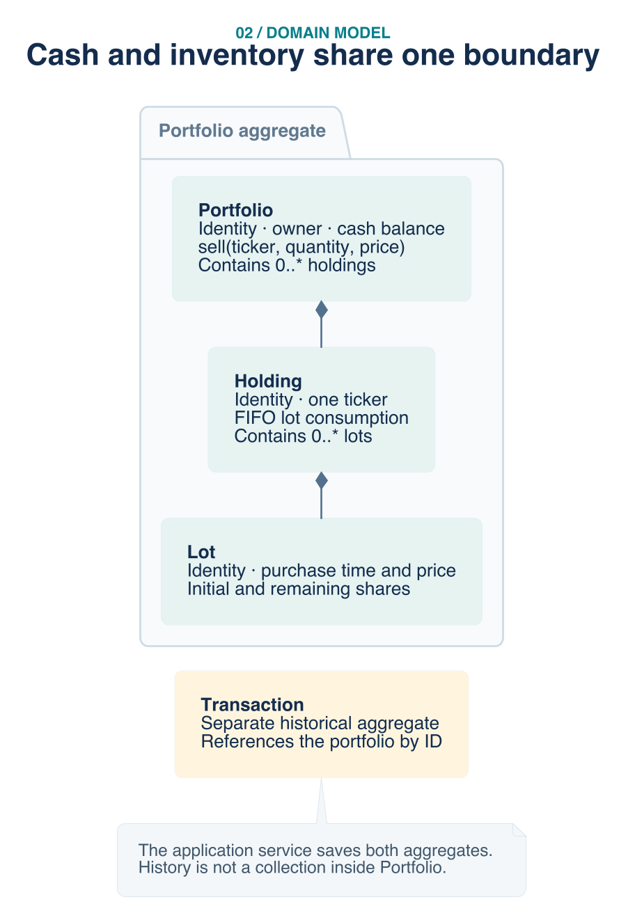

# 1. Choose a Consistency Boundary

**Goal:** decide which objects must collaborate to complete a sale correctly.

## Begin with a failure

A caller sells 12 shares but forgets to increase portfolio cash. The lot arithmetic may be correct, yet the portfolio is wrong. This tells us that share consumption and the cash update belong to one business operation.

An aggregate groups the state needed to enforce such rules. Its root is the intended entry point for updates. In HexaStock:

- `Portfolio` owns the cash balance and holdings.
- `Holding` groups lots for one ticker.
- `Lot` tracks a purchase price, purchase time and remaining shares.

`Portfolio.sell` validates the command, delegates FIFO consumption to `Holding.sell`, then adds the proceeds to cash. It does not need to read every past financial transaction to perform this calculation.

[Open the full-size diagram (SVG)](https://raw.githubusercontent.com/alfredorueda/HexaStock/main/doc/tutorial/sellStocks/diagrams/Rendered/sell-domain-model.svg)

## Separate business records from database transactions

A financial transaction records an operation that happened. The domain uses four record types: `DepositTransaction`, `WithdrawalTransaction`, `PurchaseTransaction` and `SaleTransaction`. They implement the sealed `Transaction` interface and refer to the portfolio by ID.

A database transaction groups writes so that they commit or roll back together. The sale service coordinates these writes:

1. Load the portfolio through `PortfolioPort`.
2. Fetch a quote through `StockPriceProviderPort`.
3. Invoke `portfolio.sell(...)`.
4. Save the portfolio.
5. Create and save the sale record through `TransactionPort`.

The two persisted representations can participate in one database transaction without belonging to one in-memory aggregate. See [the service walkthrough](../../tutorial/sellStocks/SELL-STOCK-05-ORCHESTRATION.md) for the actual code.

Saving the portfolio first does not mean it has already committed. The surrounding transaction completes after the service invocation. A persistence failure must roll back both writes; database integration tests are needed to establish that behavior.

## Identify the limits of the boundary

The intended update path goes through `Portfolio`, but the current API exposes mutable children. A caller can obtain a holding and invoke its methods directly. An unmodifiable returned list prevents adding or removing list entries through that list; it does not freeze its elements.

Likewise, an aggregate is not a concurrency mechanism. Two requests can load the same state unless persistence coordinates them. The JPA adapter uses pessimistic locking; MongoDB uses version checks and retries. Study [consistency](../../tutorial/sellStocks/SELL-STOCK-07-CONSISTENCY.md) after understanding the single-request operation.

Do not infer that every possible portfolio state is valid merely because it has a constructor. For example, the public reconstruction constructor accepts a `Money` balance; operation-level checks and construction-time validation are different responsibilities.

## Checkpoint

Must the portfolio load its entire transaction history to reject a sale of 20 shares when it holds 15?

**Answer:** no. Current holdings provide the necessary quantity. The application still records a successful sale consistently with the state change, but history is not required for this availability decision.

[Back to the learning path](../../DDD%20Portfolio%20and%20Transactions.md) · [Next: history and scale](02-HISTORY-AND-SCALE.md)
