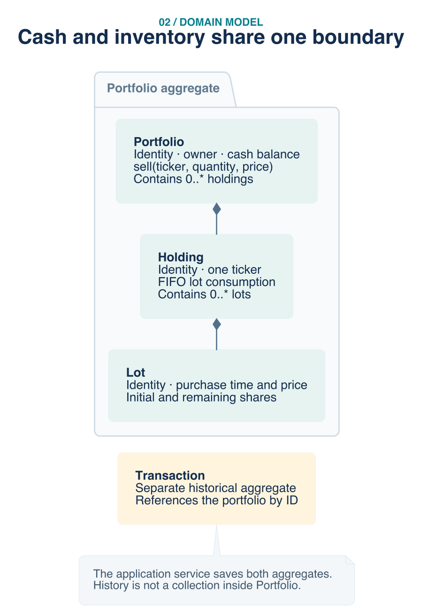

# Stock Portfolio API Specification

This reference describes the REST behavior implemented on `main`. Start with portfolio creation and cash management, then purchases and sales. Each operation now has its own short page; existing use-case and acceptance-criterion identifiers are retained.

**New to the project?** Follow [Start Here](learning/START-HERE.md) before using this as a reference. For an executable local exploration, use the [README setup](../README.md) and [HTTP request collection](https://github.com/alfredorueda/HexaStock/blob/main/doc/calls.http).

The local base URL is `http://localhost:8081`. [OpenAPI](https://github.com/alfredorueda/HexaStock/blob/main/doc/openapi.yaml) supplies the machine-readable shapes; the pages below explain behavior and limitations. Gherkin examples remain in their canonical feature files and are not executed by Cucumber.

## 1. Global Error Contract

Read [API errors and validation order](api/ERRORS.md) for the handled exception/status mappings. The custom Problem Detail advice covers specific application exceptions, not every framework or malformed-input failure.

## 2. User Stories

### 2.1 US-01 — Create Portfolio

[Read the operation contract](api/US-01-CREATE-PORTFOLIO.md).

### 2.2 US-02 — Get Portfolio

[Read the operation contract](api/US-02-GET-PORTFOLIO.md).

### 2.3 US-03 — List All Portfolios

[Read the operation contract](api/US-03-LIST-PORTFOLIOS.md).

### 2.4 US-04 — Deposit Funds

[Read the operation contract](api/US-04-DEPOSIT-FUNDS.md).

### 2.5 US-05 — Withdraw Funds

[Read the operation contract](api/US-05-WITHDRAW-FUNDS.md).

### 2.6 US-06 — Buy Stocks

[Read the operation contract](api/US-06-BUY-STOCKS.md).

### 2.7 US-07 — Sell Stocks

[Read the operation contract](api/US-07-SELL-STOCKS.md).

### 2.8 US-08 — Get Transaction History

[Read the operation contract](api/US-08-GET-TRANSACTION-HISTORY.md).

### 2.9 US-09 — Get Holdings Performance

[Read the operation contract](api/US-09-GET-HOLDINGS-PERFORMANCE.md).

### 2.10 US-10 — Get Stock Price

[Read the operation contract](api/US-10-GET-STOCK-PRICE.md).

## 3. Domain Model

`Portfolio` is the aggregate root; `Holding` and `Lot` are child entities. Financial transaction records are separate and refer to the portfolio by ID. The [shared vocabulary](tutorial/sellStocks/UBIQUITOUS-LANGUAGE.md) defines the terms, and [aggregate boundaries](architecture/aggregates/01-CONSISTENCY-BOUNDARY.md) explains their responsibilities and limits.

## 4. PlantUML Diagram

The maintained domain diagram is rendered as an image so it displays in GitBook:

[Diagram source](https://github.com/alfredorueda/HexaStock/blob/main/doc/tutorial/sellStocks/diagrams/sell-domain-model.puml).

## 5. HTTP Request File

Use [doc/calls.http](https://github.com/alfredorueda/HexaStock/blob/main/doc/calls.http). It captures the created portfolio ID and reuses it in subsequent requests. The random demonstration provider means sale amounts vary; use controlled quotes in automated tests for exact FIFO expectations.

## 6. Suggested Future Evolutions

[Behavior and extension exercises](api/BEHAVIOUR-AND-EXTENSIONS.md) separates current behavior from filtering, pagination, quote-freshness and historical-allocation proposals. Settlement, fees, reservations and watchlists are not baseline API features.

## 7. Implementation Notes and Deviations

Consult [the behavior notes](api/BEHAVIOUR-AND-EXTENSIONS.md) for decimal rounding, timestamps, currency assumptions and known limitations. In particular, transaction `type` filtering is not implemented, transaction DTOs are flat, and report provider failures do not automatically become zero prices.

## 8. Follow-up Issue Suggestions

The [extension exercises](api/BEHAVIOUR-AND-EXTENSIONS.md#reasonable-extension-exercises) identify concrete work without treating it as completed. Update requirements, OpenAPI, implementation and tests together when adopting one.

## 9. Open Specification Questions (Training Discussion) — US-07 Sell Stocks

The former questions about invalid ticker syntax and full liquidation now have explicit baseline answers in [US-07](api/US-07-SELL-STOCKS.md). Use [the comparison exercise](api/BEHAVIOUR-AND-EXTENSIONS.md#turn-former-ambiguities-into-a-review-exercise) to propose and justify a different contract.
