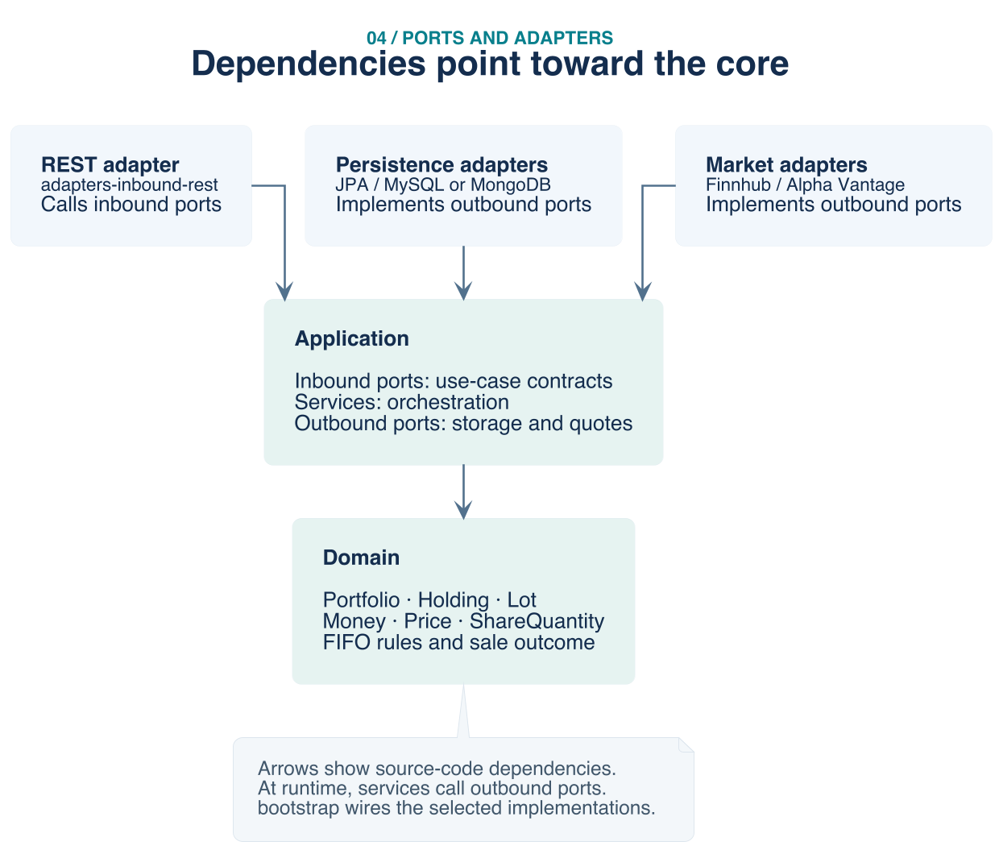

# Dependency Inversion Through a Stock Sale

**Goal:** explain why the sale service can use different quote providers without importing their implementations.

**Prerequisites:** Java interfaces and the [project overview](sellStocks/HEXASTOCK-PROJECT-OVERVIEW.md). Study this topic in two sessions:

1. Read this page and identify the source-code dependencies.
2. Continue with [wiring, tests and extension limits](dependencyInversion/WIRING-AND-TESTING.md).

## Start with the capability the service needs

A sale needs a stock price. The application should express that need without describing a provider's HTTP URL or JSON fields. Its outbound port contains this operation:

```java
StockPrice fetchStockPrice(Ticker ticker);
```

This is an excerpt from `StockPriceProviderPort` in `application.port.out`. `Ticker` and `StockPrice` are domain types. The interface also has a default set-based overload that calls the single-ticker operation for each ticker; it is not a provider-side batch request.

## Follow the two directions

The source-code relationship is:

```text
PortfolioStockOperationsService → StockPriceProviderPort ← FinhubStockPriceAdapter
```

Both classes depend on an application-owned interface. The application does not import the adapter. This is the dependency inversion that lets the core describe its needs while external code supplies the implementation.

At runtime, the service still calls an adapter object through that interface. Source dependency direction and runtime call direction are different concepts.



[Open the full-size diagram (SVG)](https://raw.githubusercontent.com/alfredorueda/HexaStock/main/doc/tutorial/sellStocks/diagrams/Rendered/sell-architecture-overview.svg)

For the original hexagonal drawing and its attribution, see [Stage 4](sellStocks/SELL-STOCK-04-HTTP-AND-PORTS.md).

## Locate the responsibilities

| Participant | Responsibility in the sale |
|---|---|
| `PortfolioRestController` | Convert HTTP input and invoke an inbound port. |
| `PortfolioStockOperationsUseCase` | Describe the application operation available to callers. |
| `PortfolioStockOperationsService` | Load the portfolio, obtain a quote, call the domain and save results. |
| `Portfolio` and `Holding` | Validate the sale and perform FIFO accounting. |
| `StockPriceProviderPort` | Describe the quote capability needed by the application. |
| Price adapter | Call a provider or generate a demonstration quote. |
| Persistence adapters | Map and store portfolio state and transaction records. |

The service depends on concrete domain objects as well as port interfaces. Dependency inversion does not mean that every type in a program must be an interface.

The domain production code has no Spring or persistence imports. The application uses Jakarta transaction annotations; bootstrap supplies the transaction infrastructure and wires the implementations. A direct Java constructor call in a unit test does not activate transaction interception.

## Checkpoint

Would moving `StockPriceProviderPort` into the Finnhub adapter module preserve the same dependency direction?

**Answer:** no. The application would need a dependency on the module containing that external detail to access its interface. In this design, the application owns the capability contract and the adapter implements it.

[Next: wiring, testing and extension limits](dependencyInversion/WIRING-AND-TESTING.md)

## References

- Cockburn, Alistair. "Hexagonal Architecture." 2005. https://alistair.cockburn.us/hexagonal-architecture/
- Evans, Eric. *Domain-Driven Design: Tackling Complexity in the Heart of Software.* Addison-Wesley, 2003.
- Martin, Robert C. "The Dependency Inversion Principle." *C++ Report*, vol. 8, no. 6, 1996, pp. 61–66. (Original statement of DIP.)
- Martin, Robert C. *Clean Architecture: A Craftsman's Guide to Software Structure and Design.* Prentice Hall, 2017. (Chs. 11 and 22.)
- Vernon, Vaughn. *Implementing Domain-Driven Design.* Addison-Wesley, 2013.

