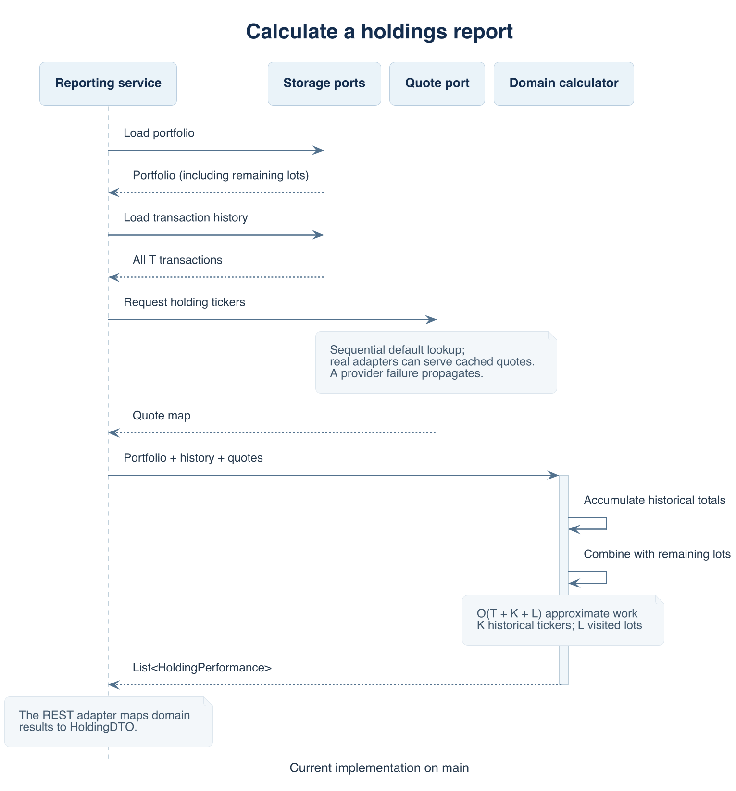

# 1. Calculate one holdings report

**Outcome:** explain a report without confusing all historical purchases with shares still owned.

## Start with an example

A portfolio buys 10 shares at $100, then 5 at $120. It sells 12 shares at $130 using FIFO. The current quote is $125.

| Metric | Calculation | Result |
|---|---|---|
| Total purchased quantity | 10 + 5 | 15 |
| Remaining quantity | 15 − 12 | 3 |
| Average historical purchase price | (10 × 100 + 5 × 120) / 15 | $106.67 |
| Realized gain | 12 × 130 − (10 × 100 + 2 × 120) | $320.00 |
| Unrealized gain | 3 × (125 − 120) | $15.00 |

Average historical purchase price is **not** the cost basis per remaining share. The three remaining shares belong to the second lot at $120. Multiplying the rounded historical average by the remaining quantity would therefore give the wrong unrealized gain.

## Follow the current implementation

[Open the full-size diagram (SVG)](https://raw.githubusercontent.com/alfredorueda/HexaStock/main/doc/tutorial/portfolioReporting/diagrams/Rendered/approachA-sequence.svg)

`ReportingService.getHoldingsPerformance()` performs these steps inside its application transaction:

1. Load the portfolio or throw `PortfolioNotFoundException`.
2. Load all its transactions through `TransactionPort`.
3. Collect tickers from its holdings and request quotes through `StockPriceProviderPort`.
4. Pass portfolio, transactions and quote map to `HoldingPerformanceCalculator`.
5. Return domain results; the REST adapter creates response DTOs.

The default set-based quote method calls the single-ticker method sequentially. Sequential execution alone does not enforce a requests-per-minute quota. The real provider adapters already cache quotes; the random mock is a different test/development option.

## What the calculator does

A `LinkedHashMap<Ticker, TickerAccumulator>` stores three totals per historical stock ticker: purchased quantity, purchased cost, and realized gain. One pass over transactions updates them. Cash transactions have a null ticker and are skipped.

For each ticker, a second loop combines those totals with the holding's remaining lots and the supplied quote. The domain returns `List<HoldingPerformance>`, not a web DTO list. Average purchase price is divided to scale 2 using `HALF_UP`; this is different from `HALF_EVEN`, often called banker's rounding.

Let T be transaction count, K distinct stock tickers in history, and L the remaining lots visited while calculating results. The transaction scan is O(T); the whole calculator is approximately O(T + K + L), assuming usual map access costs and bounded numeric sizes. Accumulators and results add O(K) space. Inputs have already been loaded and consume additional memory.

## Empty holdings and missing prices

Selling the last share removes depleted lots but retains the holding. A historical ticker can therefore still appear in the report with zero remaining quantity and realized gain.

The calculator supplies zero current price and unrealized gain when a ticker is absent from the supplied quote map. That local fallback does **not** mean the HTTP report catches provider failures. The service does not catch `ExternalApiException`; the REST advice maps it to 503. Distinguish a unit-test input with a missing map entry from a failed external request.

## Checkpoint

Change the quote in the example to $110. Remaining quantity and realized gain stay the same; unrealized gain becomes −$30.00. Explain why average purchase price also stays the same.

Run the [domain test route](../sellStocks/SELL-STOCK-DOMAIN-TUTORIAL.md) before inspecting database performance.

Next: [measure the request](02-MEASUREMENT.md). [Chapter index](HOLDINGS-PERFORMANCE-AT-SCALE.md).
