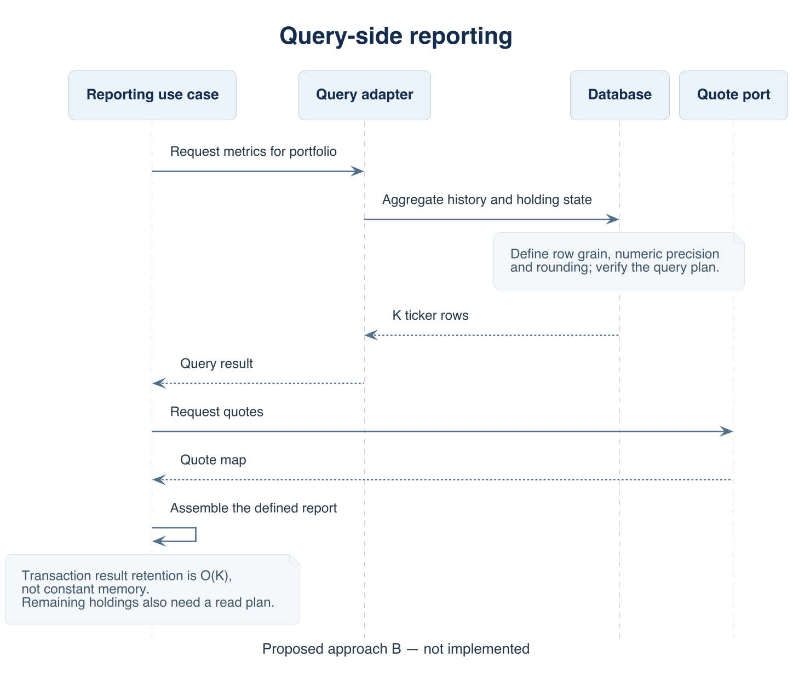
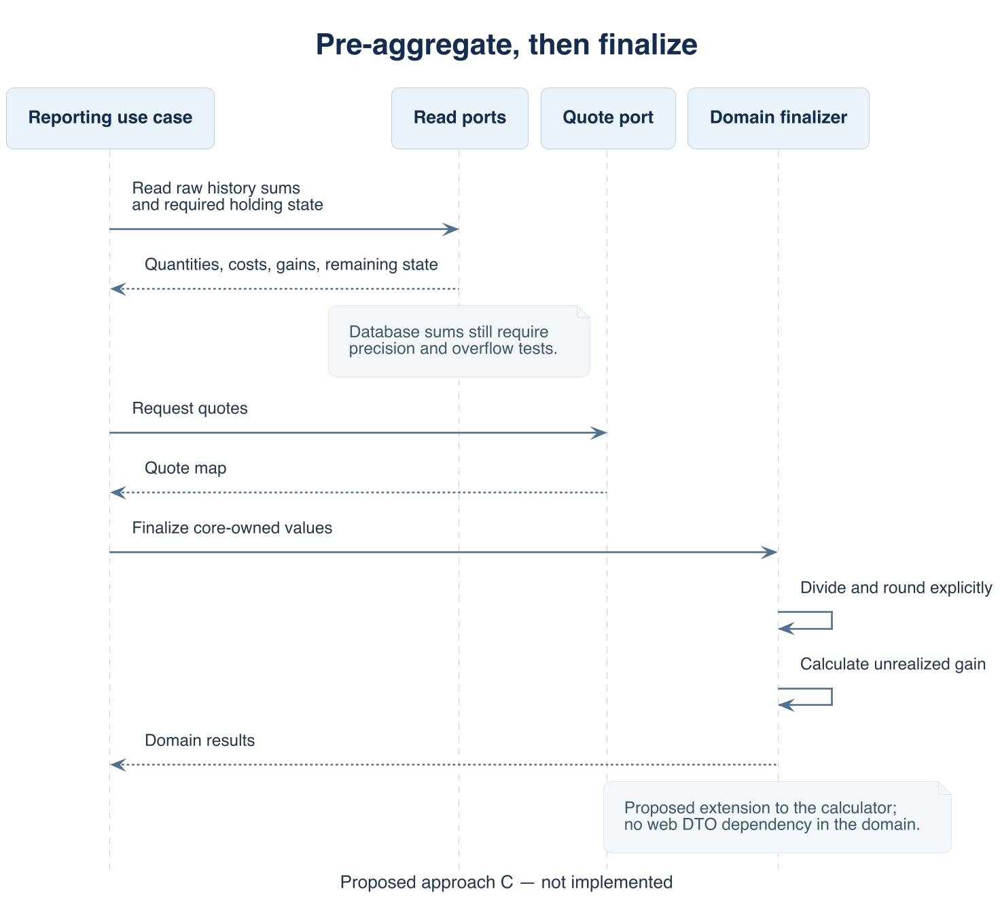

# 3. Aggregate through a query port

**Status:** proposed alternatives B and C, not implemented on `main`. **Outcome:** design a smaller query result while preserving reporting semantics.

## B: database aggregation

Instead of hydrating every transaction, a query can return one row per historical stock ticker. This reduces transaction-result transfer and JVM retention from O(T) to O(K), where K is the number of distinct tickers. It is not O(1) memory, and loading the full portfolio can still add substantial work.



[Open the full-size diagram (SVG)](https://raw.githubusercontent.com/alfredorueda/HexaStock/main/doc/tutorial/portfolioReporting/diagrams/Rendered/approachB-sequence.svg)

A starting SQL sketch is:

```sql
SELECT ticker,
       SUM(CASE WHEN type = 'PURCHASE' THEN quantity ELSE 0 END) AS bought_qty,
       SUM(CASE WHEN type = 'PURCHASE'
                THEN quantity * unit_price ELSE 0 END) AS bought_cost,
       SUM(CASE WHEN type = 'SALE' THEN profit ELSE 0 END) AS realized_gain
FROM transactions
WHERE portfolio_id = :portfolioId
  AND type IN ('PURCHASE', 'SALE')
GROUP BY ticker;
```

This is a proposed query, not a drop-in repository method. Check physical column names, enum storage, numeric types, indexes and execution plans against the chosen adapter. Bind `portfolioId`; do not concatenate user input into SQL. Null handling and empty-result behavior need explicit tests.

A full query-side design must also supply remaining quantity and remaining cost basis, or obtain them separately. Historical purchased cost is not remaining cost after FIFO sales. Joining purchase history directly to many lots can multiply rows and inflate sums: aggregate each source at the intended grain before joining.

## C: raw sums in storage, final calculations in the domain

A hybrid query returns purchased quantity, purchased cost and realized gain. Java combines those values with remaining holdings and quotes, and performs defined division and rounding.



[Open the full-size diagram (SVG)](https://raw.githubusercontent.com/alfredorueda/HexaStock/main/doc/tutorial/portfolioReporting/diagrams/Rendered/approachC-sequence.svg)

One possible new port contract is:

```java
public interface TransactionQueryPort {
    List<RawTickerAggregate> getRawAggregates(PortfolioId portfolioId);
}

public record RawTickerAggregate(
        String ticker,
        BigDecimal boughtQuantity,
        BigDecimal boughtCost,
        BigDecimal realizedGain) {}
```

These declarations are design sketches; package placement and imports are omitted. They are not existing classes. The port belongs to the application boundary, and its adapter supplies the database-specific query. A domain finalizer should consume an appropriate core-owned representation rather than importing a REST DTO.

Keeping final arithmetic in Java makes the rounding policy visible and independently testable. It does not guarantee correctness by itself. SQL sums and products can overflow or be coerced depending on column precision and expression types. Java and database implementations must agree on scale, negative values, rounding ties and missing data. `HALF_UP` and `HALF_EVEN` differ; choose the specified policy explicitly.

## Compare the costs

| Choice | Benefit | New obligation |
|---|---|---|
| A: current in-memory history | Direct domain testability | Load and retain full history |
| B: query-side calculations | Smaller transfer; database execution options | Verify complete numeric and query semantics in adapter tests |
| C: raw aggregates plus Java finalization | Smaller transfer with explicit core calculations | Maintain a new port and prove equivalence across its boundary |

A query adapter does not automatically violate hexagonal architecture. The key questions are who owns the contract, where policy is defined and how equivalence is verified. No option guarantees performance for millions of rows without an execution plan and measurements.

## Exercise: prove equivalence before timing

Use the numerical example from lesson 1, then add an empty portfolio, a fully sold position, several tickers, negative realized gain and a rounding tie. Compare the original calculator with the proposed query path. Run query tests against the actual database engine and measure under the workload from lesson 2.

Next: [snapshots and recovery](04-SNAPSHOTS.md). [Chapter index](HOLDINGS-PERFORMANCE-AT-SCALE.md).
