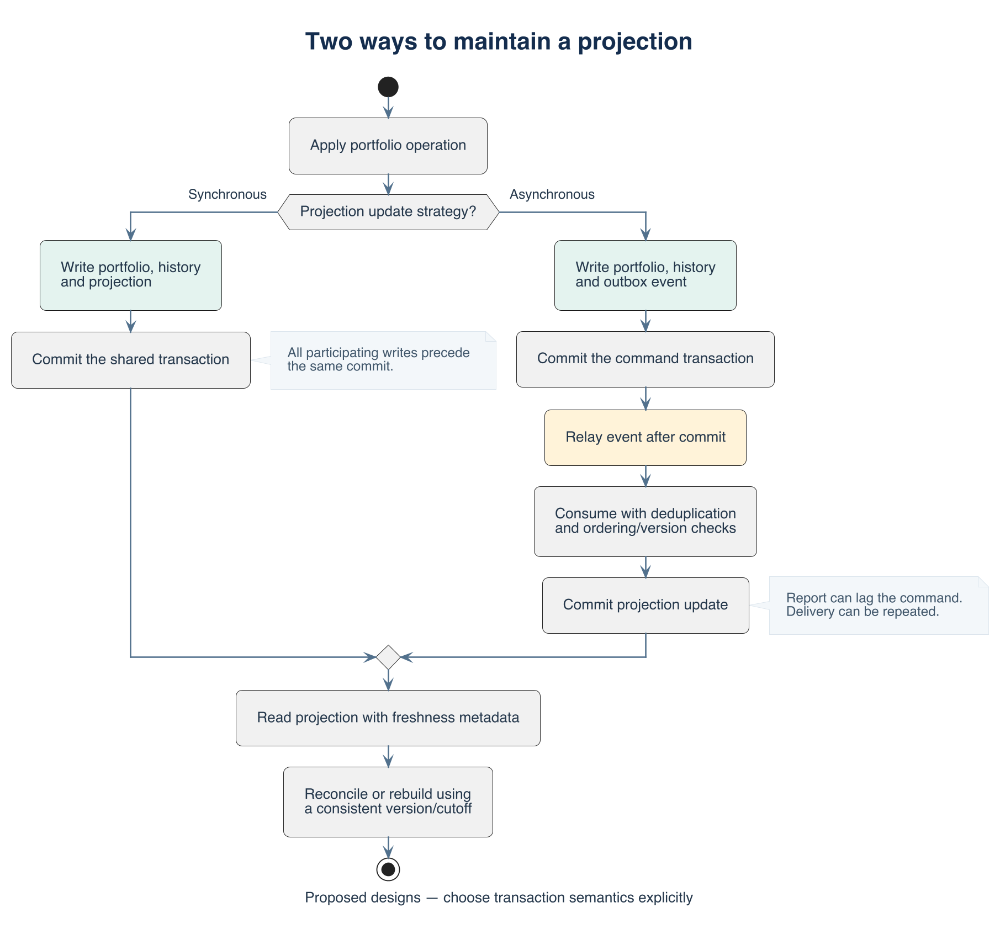

# 4. Maintain a reporting projection

**Status:** advanced design exercise; no snapshot updater or outbox is implemented on `main`. **Outcome:** explain the consistency and recovery costs of precomputed reports.

A projection stores data shaped for a query. For example, one row per portfolio and ticker could hold total purchased quantity and cost, remaining quantity and realized gain. Reading those rows avoids re-aggregating all historical transactions, but the system must keep them correct.

[Open the full-size diagram (SVG)](https://raw.githubusercontent.com/alfredorueda/HexaStock/main/doc/tutorial/portfolioReporting/diagrams/Rendered/snapshot-architecture.svg)

## Option 1: update within the command transaction

Write the portfolio, transaction record and projection **before the same transaction commits**, using resources that participate in that transaction. If it rolls back, all those writes roll back. This can provide atomic visibility for that stored state under the chosen database semantics.

An update invoked after commit is not part of the original transaction. Do not describe an after-commit listener as providing the same atomicity. Quotes read later also have their own timestamps and are not made current by the projection transaction.

The additional write can increase latency and contention. Test rollback and concurrent updates, and decide how schema changes and rebuilding will work.

## Option 2: update asynchronously

A separate consumer can update the projection after the command commits. That introduces a period in which the report trails the write model. Whether this is acceptable is a requirement to establish, not a universal property of financial dashboards.

Publishing an in-memory event after commit can lose delivery if the process fails between commit and publication. Publishing before commit can expose an event for a transaction that later rolls back. A [transactional outbox](https://microservices.io/patterns/data/transactional-outbox.html) persists the event with the command and relays it later. Relays can deliver duplicates, so consumers need deduplication or idempotent updates, plus ordering/version handling.

A plain Spring `@EventListener` does not by itself provide asynchronous execution, durable delivery or correct transaction timing. Those are separate design decisions.

## Make freshness visible

Define what readers can rely on:

- A projection version or processed sequence identifies which committed changes it includes.
- A timestamp can communicate age but does not, on its own, prove all earlier events were processed.
- Read-your-writes may require waiting for a version, returning command results directly, or using another read path.
- A stale-report fallback needs its own capacity budget; an outage must not trigger unlimited expensive recalculation.

Commands that decide whether shares or cash are available must use their authoritative consistency mechanism, rather than an asynchronously stale report.

## Rebuild without overwriting newer work

Reconciliation compares a projection with an authoritative recomputation. A naive read–compare–overwrite loop can overwrite a newer consumer update. Specify a consistent cutoff/version and use version checks, a controlled rebuild, or a swap to a newly built projection.

Plan for duplicate events, gaps, reordering, consumer restarts, schema evolution and concurrent rebuilds. Record lag, reconciliation differences and failed processing. Pick recovery objectives from requirements; “hourly” or “daily” is not inherently sufficient.

The existing transaction history records totals, not every possible future audit or correction event. Determine whether it contains enough information for the projection you propose before claiming it can rebuild any view.

## Checkpoint

Trace a crash immediately after the command commits but before a message is sent. Explain how an outbox changes the recovery path, then explain why duplicate delivery remains a separate problem.

CQRS means using distinct models for changes and queries; it does not require a broker, event sourcing, separate services or unlimited scalability. Its extra moving parts need a concrete benefit. See [Fowler's discussion](https://martinfowler.com/bliki/CQRS.html).

[Chapter index](HOLDINGS-PERFORMANCE-AT-SCALE.md).
