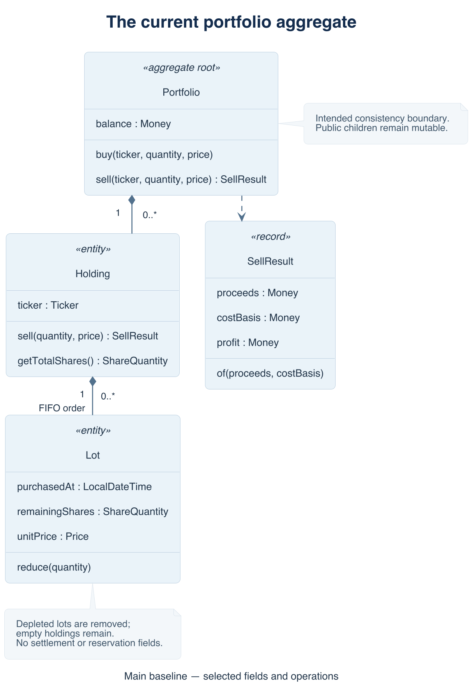
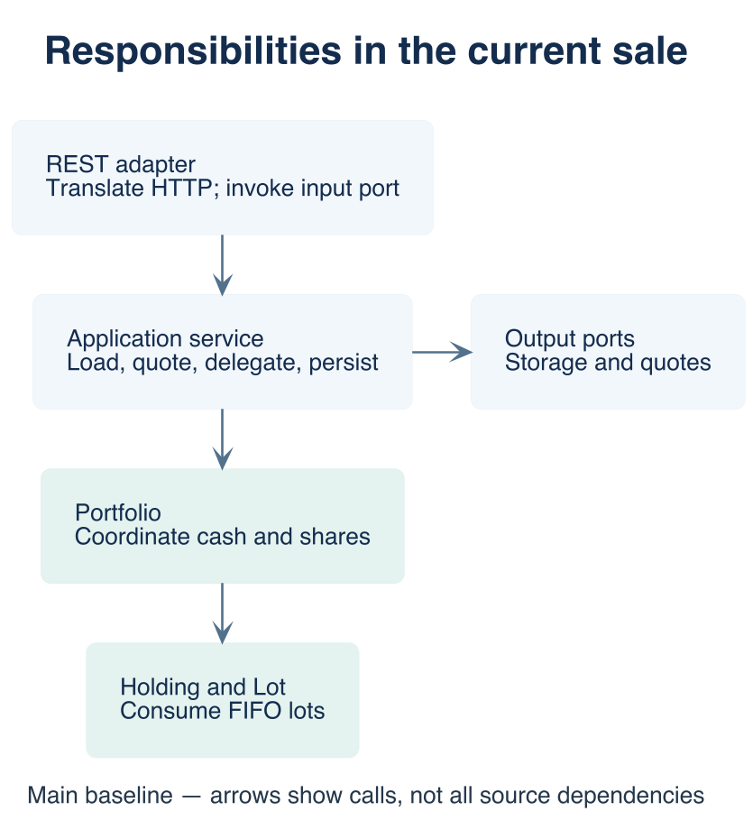
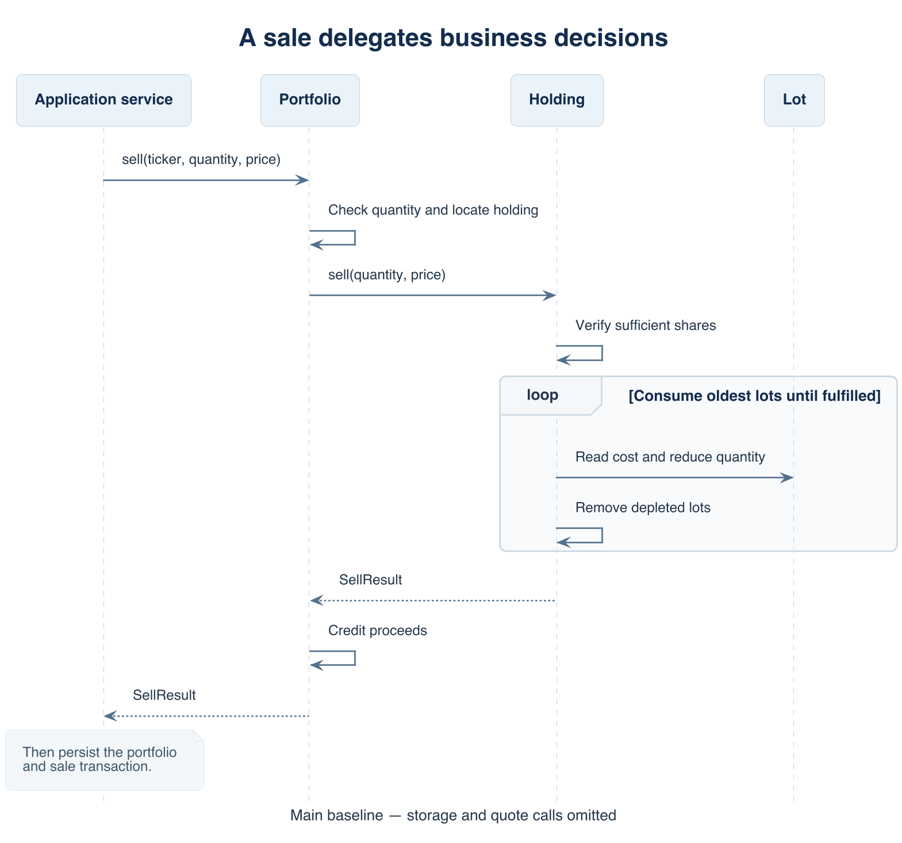

# 1. Inspect the current model

**Outcome:** explain the baseline sale without introducing settlement or fees.

[Open the full-size diagram (SVG)](https://raw.githubusercontent.com/alfredorueda/HexaStock/main/doc/tutorial/richVsAnemicDomainModel/diagrams/Rendered/domain-model.svg)

## Assign each responsibility

| Responsibility | Current owner |
|---|---|
| Translate an HTTP sale request | `PortfolioRestController` |
| Load state, obtain a quote, save portfolio and transaction | `PortfolioStockOperationsService` |
| Coordinate cash and holding changes | `Portfolio.sell()` |
| Consume purchase lots in FIFO order | `Holding.sell()` |
| Reduce a lot's remaining shares | `Lot.reduce()` |
| Derive profit from proceeds and cost basis | `SellResult.of()` |

The service calls ports for infrastructure interactions. It does not import a concrete database adapter or repeat the FIFO loop. Its transaction boundary is part of application coordination; a quote provider and repository supply mechanisms behind those ports.

[Open the full-size diagram (SVG)](https://raw.githubusercontent.com/alfredorueda/HexaStock/main/doc/tutorial/richVsAnemicDomainModel/diagrams/Rendered/rich-architecture.svg)

A sale of 12 shares after buying 10 at $100 and 5 at $120, at a sale price of $130, consumes the first lot and two shares of the second. Cost basis is $1,240; proceeds are $1,560; profit is $320. The portfolio credits proceeds and retains three shares at a $120 purchase price.

[Open the full-size diagram (SVG)](https://raw.githubusercontent.com/alfredorueda/HexaStock/main/doc/tutorial/richVsAnemicDomainModel/diagrams/Rendered/rich-sell-sequence.svg)

## Rich does not mean completely protected

The intended entry point is the portfolio root, but public accessors expose mutable holdings and lots. Copying a list without permitting structural changes does not make its elements immutable. Review callers and visibility before claiming that bypass is impossible.

`SellResult.of()` derives profit, but the public record constructor also exists. A factory method is not the only construction path unless the type's design actually enforces that restriction. Similarly, value objects enforce selected constraints rather than every business rule: `Money` permits negative values, while deposit and withdrawal operations impose their own checks.

This is why behavior tests and API review remain useful even with a rich model. The architectural intention and the guarantees of the current implementation are related but distinct.

## Checkpoint

Locate the FIFO loop in [Holding](https://github.com/alfredorueda/HexaStock/blob/main/domain/src/main/java/cat/gencat/agaur/hexastock/model/portfolio/Holding.java), then the call in [the application service](https://github.com/alfredorueda/HexaStock/blob/main/application/src/main/java/cat/gencat/agaur/hexastock/application/service/PortfolioStockOperationsService.java). Explain why recording a completed sale is application coordination while selecting lots is a business rule.

For the full walkthrough, use [the domain lessons](../sellStocks/SELL-STOCK-DOMAIN-TUTORIAL.md).

Next: [diagnose duplicated rules](02-RULE-DRIFT.md). [Chapter index](RICH_VS_ANEMIC_DOMAIN_MODEL_TUTORIAL.md).
