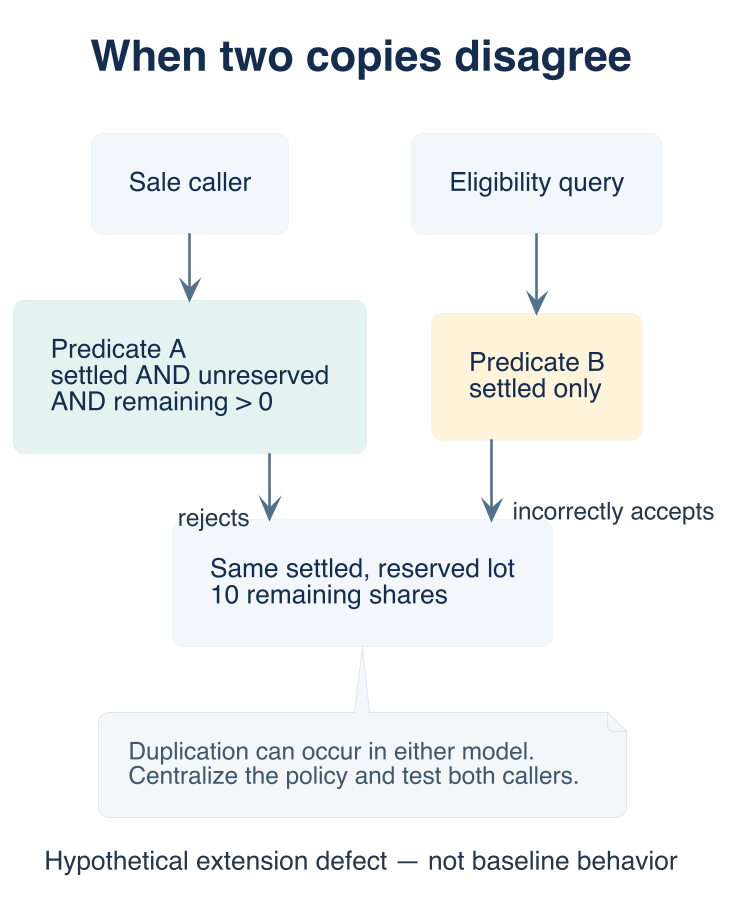
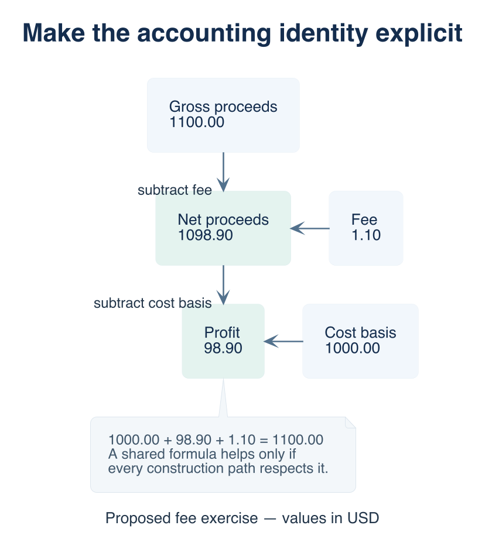
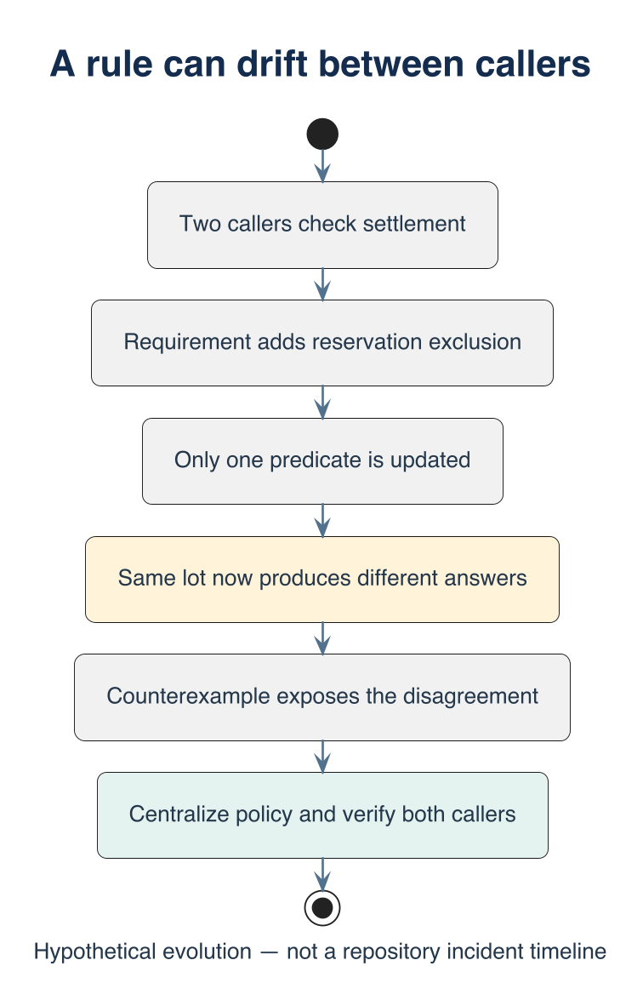
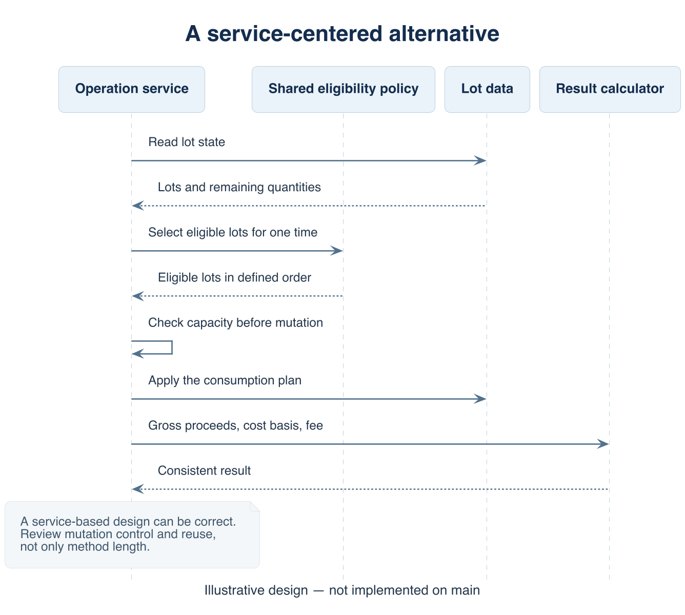

# 2. Diagnose duplicated rules

**Status:** hypothetical teaching example, not a report of defects in an experimental branch. **Outcome:** show a disagreement with the smallest useful counterexample.

## One question, two implementations

Suppose an extension defines a lot as eligible when it is settled, unreserved and nonempty. A sale handler implements all three checks, but an eligibility query checks settlement alone.

```java
// Illustrative predicates; these are not baseline Lot methods.
boolean eligibleForSale(boolean settled, boolean reserved, int remaining) {
    return settled && !reserved && remaining > 0;
}

boolean eligibleForQuery(boolean settled, boolean reserved, int remaining) {
    return settled; // Deliberate defect: ignores reservation and quantity.
}
```

For a settled, reserved lot containing ten shares, the first predicate rejects it and the second accepts it. This counterexample is stronger evidence than counting how many lines each implementation occupies.



[Open the full-size diagram (SVG)](https://raw.githubusercontent.com/alfredorueda/HexaStock/main/doc/tutorial/richVsAnemicDomainModel/diagrams/Rendered/anemic-architecture.svg)

A model made of data carriers does not require duplication. It can delegate both callers to a shared policy. A rich model can also be implemented badly by leaving obsolete predicates elsewhere. Diagnose ownership and reuse, not only the class name in which code appears.

## A second counterexample: fees

For gross proceeds of $1,100, cost basis of $1,000 and a fee of $1.10, the exercise defines net proceeds as $1,098.90 and profit as $98.90. A copied pre-fee formula returns $100.00.

```text
netProceeds = grossProceeds - fee
profit = netProceeds - costBasis
costBasis + profit + fee = grossProceeds
```

A shared result factory or calculator can reduce formula duplication. All construction paths still need review; a public constructor that accepts independently supplied totals can admit inconsistent values unless it validates them.



[Open the full-size diagram (SVG)](https://raw.githubusercontent.com/alfredorueda/HexaStock/main/doc/tutorial/richVsAnemicDomainModel/diagrams/Rendered/invariant-enforcement.svg)

## How drift can arise



[Open the full-size diagram (SVG)](https://raw.githubusercontent.com/alfredorueda/HexaStock/main/doc/tutorial/richVsAnemicDomainModel/diagrams/Rendered/rule-drift.svg)

The timeline is hypothetical: first two callers agree, then one is updated, then the other produces an inconsistent answer. It is not a claim about named developers, real sprints or a production incident.

An eligible-shares query is not inherently a design error. Users may need that information. Exposing a lot identifier can also be justified by a reservation use case. The relevant issue is whether the operation has a coherent contract and respects the aggregate's invariants.

## Alternative service-centered design



[Open the full-size diagram (SVG)](https://raw.githubusercontent.com/alfredorueda/HexaStock/main/doc/tutorial/richVsAnemicDomainModel/diagrams/Rendered/anemic-sell-sequence.svg)

A service can use one policy and one calculation path over data carriers. Compare its coupling, mutation control and testing burden with aggregate methods. Do not compare a correct rich model with deliberately broken service code and call that a general proof of superiority.

**Checkpoint:** write a truth table for settled, reserved and empty lots. Identify a test that fails if either caller stops using the shared policy.

Next: [specify the extension](03-SETTLEMENT-EXERCISE.md). [Chapter index](RICH_VS_ANEMIC_DOMAIN_MODEL_TUTORIAL.md).
