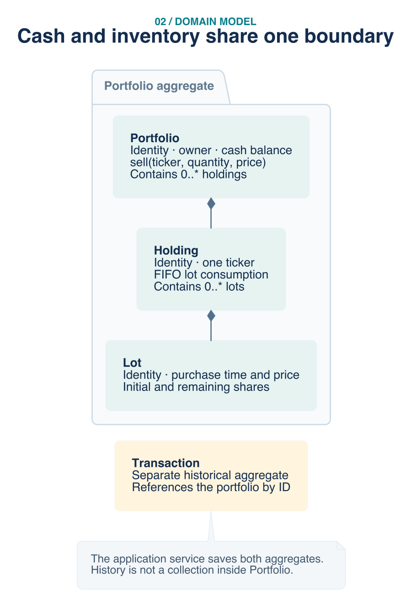

# 2. Model and test the aggregate

**Goal:** Express the sale as an observable domain behaviour.

**Study time:** 15–20 minutes, including the checkpoint. **Before starting:** complete [Stage 1](SELL-STOCK-01-BEHAVIOUR.md).

## Choose the consistency boundary

`Portfolio` owns the cash balance and its `Holding` entities; each holding contains `Lot` entities. A sale must keep cash and inventory consistent, so application code initiates it through `Portfolio.sell(...)`.

`Holding` and `Lot` have identities, but they are **not separate aggregate roots in this flow**. The historical `Transaction` record is a separate aggregate written by the application service; it is not an ever-growing collection inside `Portfolio`.



[Open the scalable diagram](https://github.com/alfredorueda/HexaStock/blob/main/doc/tutorial/sellStocks/diagrams/Rendered/sell-domain-model.svg) · [PlantUML source](https://github.com/alfredorueda/HexaStock/blob/main/doc/tutorial/sellStocks/diagrams/sell-domain-model.puml)

## Read the types before the algorithm

| Type | Role in the sale |
| --- | --- |
| `Ticker` | A validated stock symbol |
| `ShareQuantity` | Whole, non-negative shares; zero can represent depleted state |
| `Price` | Per-share price, normalized to two decimal places |
| `Money` | A monetary amount; negative values can represent a loss |
| `PortfolioId`, `HoldingId`, `LotId` | Identity values with distinct Java types |
| `SellResult` | Immutable result containing proceeds, cost basis and profit |

`ShareQuantity.of(0)` is valid state. `ShareQuantity.positive(0)` rejects an invalid command. `Portfolio.sell(...)` also rejects zero, protecting callers that do not enter through HTTP.

The sell path uses `SellResult.of(proceeds, costBasis)` to derive profit. The record's public three-argument constructor does not itself check that relationship; do not infer stronger guarantees from the word “record”. Likewise, `Price` checks positivity before rounding: it is not a general monetary-validation solution for every precision policy.

## Turn the scenario into a test

The existing [PortfolioTest.java](https://github.com/alfredorueda/HexaStock/blob/main/domain/src/test/java/cat/gencat/agaur/hexastock/model/portfolio/PortfolioTest.java) contains `shouldSellSharesUsingFIFOThroughPortfolioAggregateRoot_GherkinScenario`, annotated with `US-07.FIFO-2`. Read that method first.

For a standalone version without hidden test fixtures, this complete class can be placed in `domain/src/test/java/SellStockTutorialTest.java` in a practice checkout:

```java
import cat.gencat.agaur.hexastock.model.market.Ticker;
import cat.gencat.agaur.hexastock.model.money.Money;
import cat.gencat.agaur.hexastock.model.money.Price;
import cat.gencat.agaur.hexastock.model.money.ShareQuantity;
import cat.gencat.agaur.hexastock.model.portfolio.Holding;
import cat.gencat.agaur.hexastock.model.portfolio.Lot;
import cat.gencat.agaur.hexastock.model.portfolio.Portfolio;
import cat.gencat.agaur.hexastock.model.portfolio.SellResult;
import org.junit.jupiter.api.Test;

import static org.junit.jupiter.api.Assertions.assertEquals;

class SellStockTutorialTest {
    @Test
    void sellsOldestLotsAndCreditsProceeds() {
        Ticker aapl = Ticker.of("AAPL");
        Portfolio portfolio = Portfolio.create("Alice");
        portfolio.deposit(Money.of("10000.00"));
        portfolio.buy(aapl, ShareQuantity.of(10), Price.of("100.00"));
        portfolio.buy(aapl, ShareQuantity.of(5), Price.of("120.00"));
        Money balanceBefore = portfolio.getBalance(); // 8400.00

        SellResult result = portfolio.sell(
                aapl, ShareQuantity.of(12), Price.of("150.00"));

        assertEquals(Money.of("1800.00"), result.proceeds());
        assertEquals(Money.of("1240.00"), result.costBasis());
        assertEquals(Money.of("560.00"), result.profit());
        assertEquals(balanceBefore.add(result.proceeds()), portfolio.getBalance());
        Holding holding = portfolio.getHolding(aapl);
        assertEquals(ShareQuantity.of(3), holding.getTotalShares());
        assertEquals(1, holding.getLots().size());
        Lot survivor = holding.getLots().getFirst();
        assertEquals(Price.of("120.00"), survivor.getUnitPrice());
        assertEquals(ShareQuantity.of(3), survivor.getRemainingShares());
    }
}
```

The initial deposit is test setup, not part of the sell operation. After buying both lots the balance is 8400.00; after the sale it is 10200.00.

## Run the existing tests

From the repository root with **JDK 21** selected:

```bash
./mvnw -pl domain -Dtest=PortfolioTest,HoldingTest test
```

If you created the standalone class, run it with `./mvnw -pl domain -Dtest=SellStockTutorialTest test`.

The aggregate test checks cash and inventory together. `HoldingTest` isolates lot consumption. Neither test starts a database or proves transaction rollback under concurrent HTTP requests; those are separate concerns.

**Source to inspect:** [Portfolio.java](https://github.com/alfredorueda/HexaStock/blob/main/domain/src/main/java/cat/gencat/agaur/hexastock/model/portfolio/Portfolio.java).

## Checkpoint

Explain why a test of `Holding.sell(...)` alone cannot verify the complete sale. Then identify the assertions that distinguish the two purchase lots.

**Check your answer:** A holding cannot observe or credit portfolio cash. The aggregate test checks that cash increases by proceeds and that the surviving lot has price **120.00** and **3 shares**, connecting the financial result to the actual lot state.

**Stop here** when you can explain the answer without looking at the code. You can resume at the next stage later.

---

[Previous](SELL-STOCK-01-BEHAVIOUR.md) · [Learning path](SELL-STOCK-TUTORIAL.md) · [Next: Stage 3](SELL-STOCK-03-FIFO.md)
