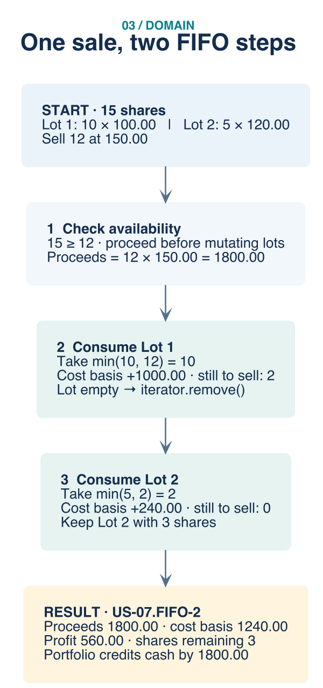

# 3. Follow the FIFO algorithm

**Goal:** Trace every lot mutation and explain the invariants.

**Study time:** 15–20 minutes, including the checkpoint. **Before starting:** complete [Stage 2](SELL-STOCK-02-DOMAIN-TEST.md).

## Enter through Portfolio

The production method in [Portfolio.java](https://github.com/alfredorueda/HexaStock/blob/main/domain/src/main/java/cat/gencat/agaur/hexastock/model/portfolio/Portfolio.java) is shown below with explanatory comments omitted:

```java
public SellResult sell(Ticker ticker, ShareQuantity quantity, Price price) {
    // ShareQuantity allows zero for domain state (e.g. depleted lots, arithmetic results).
    // Operational commands like sell require strictly positive quantities.
    // See ShareQuantity Javadoc — "Design Note: Why Zero Is Allowed".
    if (!quantity.isPositive()) {
        throw new InvalidQuantityException("Quantity must be positive");
    }

    if (!holdings.containsKey(ticker)) {
        throw new HoldingNotFoundException("Holding not found in portfolio: " + ticker);
    }

    Holding holding = holdings.get(ticker);
    SellResult result = holding.sell(quantity, price);
    balance = balance.add(result.proceeds());

    return result;
}
```

The order matters: reject an invalid quantity, locate the holding, execute the sale, then credit proceeds. If the holding rejects an oversized request, the balance update is never reached.

## Trace Holding one iteration at a time

The algorithm in [Holding.java](https://github.com/alfredorueda/HexaStock/blob/main/domain/src/main/java/cat/gencat/agaur/hexastock/model/portfolio/Holding.java):

```java
public SellResult sell(ShareQuantity quantity, Price sellPrice) {
    if (getTotalShares().isLessThan(quantity)) {
        throw new ConflictQuantityException(
                "Not enough shares to sell. Available: " + getTotalShares().value()
                        + ", Requested: " + quantity.value());
    }

    Money proceeds = sellPrice.multiply(quantity);
    Money costBasis = Money.ZERO;
    ShareQuantity remaining = quantity;

    Iterator<Lot> iterator = lots.iterator();
    while (remaining.isPositive() && iterator.hasNext()) {
        Lot lot = iterator.next();
        ShareQuantity take = lot.getRemainingShares().min(remaining);
        costBasis = costBasis.add(lot.calculateCostBasis(take));
        lot.reduce(take);
        remaining = remaining.subtract(take);
        if (lot.isEmpty()) {
            iterator.remove();
        }
    }

    return SellResult.of(proceeds, costBasis);
}
```

The availability check runs **before mutation**. It prevents a request for 16 shares from consuming all 15 and only then discovering the shortfall.

For the 12-share example:

| Iteration | Take | Cost added | Still to sell | Lot after the step |
| --- | ---: | ---: | ---: | --- |
| Lot 1 | 10 | 1000.00 | 2 | Empty; removed immediately |
| Lot 2 | 2 | 240.00 | 0 | 3 shares remain |

`iterator.remove()` safely removes the current depleted lot during traversal. `Lot.calculateCostBasis(take)` multiplies its purchase price by `take`; `Lot.reduce(take)` rejects a reduction greater than the remaining quantity and subtracts it. These methods live in [Lot.java](https://github.com/alfredorueda/HexaStock/blob/main/domain/src/main/java/cat/gencat/agaur/hexastock/model/portfolio/Lot.java).



[Open the scalable diagram](https://raw.githubusercontent.com/alfredorueda/HexaStock/main/doc/tutorial/sellStocks/diagrams/Rendered/sell-domain-fifo.svg) · [PlantUML source](https://github.com/alfredorueda/HexaStock/blob/main/doc/tutorial/sellStocks/diagrams/sell-domain-fifo.puml)

## Where does FIFO order come from?

The loop follows the list order; it does not sort during a sale. Ordinary purchases append lots. When rebuilding a holding from persistence, `addLotFromPersistence(...)` inserts lots chronologically by `purchasedAt`. JPA also requests timestamp ordering, but the domain reconstruction hook protects ordering when another adapter supplies unsorted lots.

Equal purchase timestamps have no explicit secondary ordering key. The examples use a known purchase order; a stronger tie-breaking policy would be a separate model change.

## Understand the boundary's limits

The intended application entry point is `Portfolio.sell(...)`. However, `getHolding()` returns a mutable entity and `List.copyOf(...)` protects only the collection structure, not the mutable objects inside it. Java does not make bypassing the root impossible in this implementation. Calling `holding.sell(...)` directly from an application service could reduce inventory without crediting portfolio cash.

Similarly, calling `Holding.sell(ShareQuantity.ZERO, ...)` directly bypasses the root's positive-command check. The design convention, code review and tests matter alongside type safety.

When the last lot is sold, the loop removes the lot. `Portfolio.sell(...)` does **not** remove the now-empty holding from the portfolio map. Do not confuse these two behaviours.

## Checkpoint

Trace a request for 16 shares from the initial 15-share holding. Then explain what remains in the portfolio after selling exactly 15 shares.

**Check your answer:** The 16-share request throws `ConflictQuantityException` before any lot or balance changes. Selling 15 removes both lots, credits **2250.00**, and leaves an empty holding in the portfolio.

**Stop here** when you can explain the answer without looking at the code. You can resume at the next stage later.

---

[Previous](SELL-STOCK-02-DOMAIN-TEST.md) · [Learning path](SELL-STOCK-TUTORIAL.md) · [Next: Stage 4](SELL-STOCK-04-HTTP-AND-PORTS.md)
