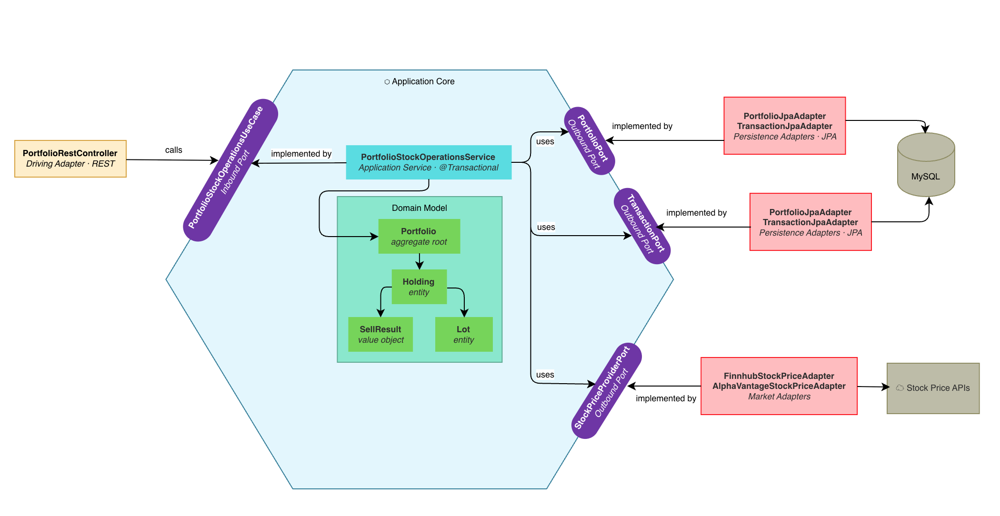
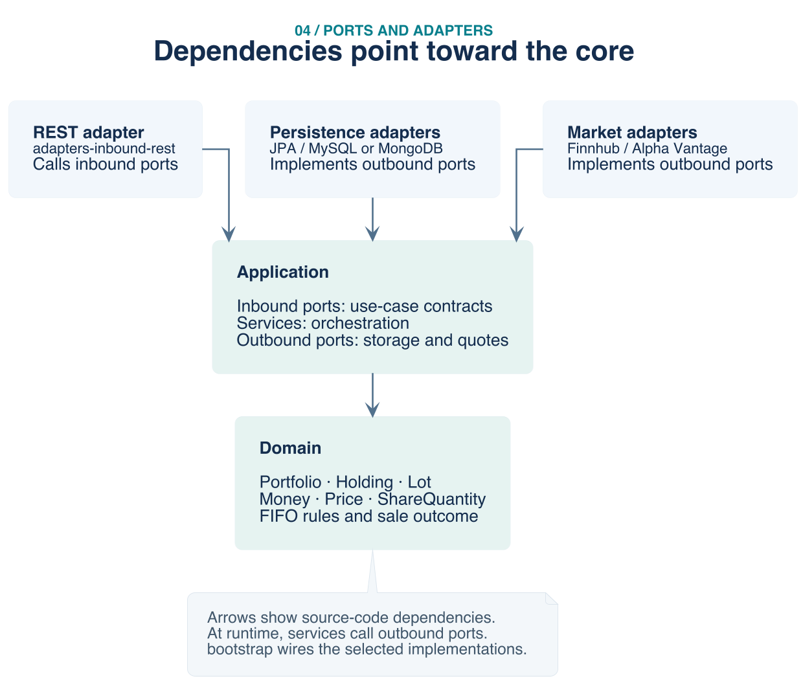
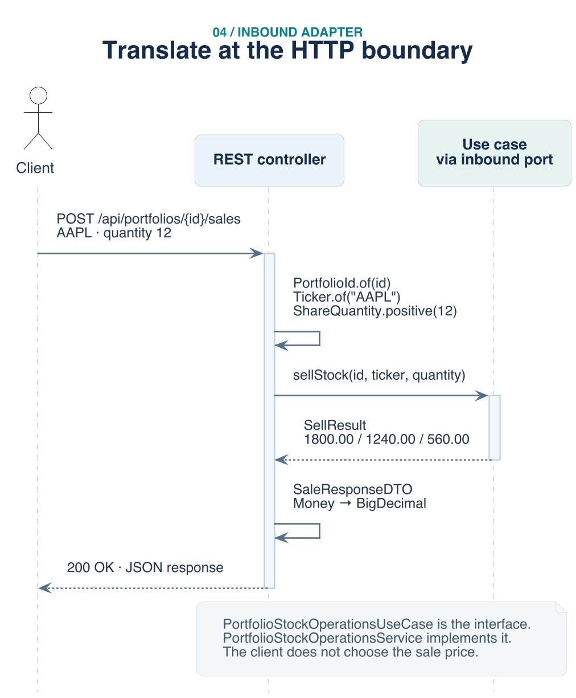

# 4. Cross the HTTP boundary

**Goal:** Map a request onto the ports and Maven modules.

**Study time:** 10–15 minutes, including the checkpoint. **Before starting:** complete [Stage 3](SELL-STOCK-03-FIFO.md).

## The original hexagonal view

This original overview places the application core inside the hexagon, with the REST adapter on the left and persistence and market adapters on the right. Ports sit on the boundary; the application service coordinates the domain model within it.

[](https://github.com/alfredorueda/HexaStock/blob/main/doc/tutorial/sellStocks/diagrams/Rendered/HexaStock_Hexagonal_Diagram_Code_Dependencies.png)

*Original diagram developed with the collaboration of Víctor García. Open the image to inspect it at full size.*

The image retains its original labels and shows the JPA/MySQL configuration. In the current code, the persistence adapters are named `JpaPortfolioRepository` and `JpaTransactionRepository`, and the Finnhub implementation is `FinhubStockPriceAdapter`. The module map below also includes the alternative MongoDB adapter.

## Map the modules to responsibilities

The domain behaviour already works without HTTP. Hexagonal Architecture connects it to the outside world through ports owned by the application core.

| Maven module | Responsibility |
| --- | --- |
| `domain` | Business objects and rules, with no production framework imports |
| `application` | Use cases, orchestration and port interfaces |
| `adapters-inbound-rest` | Controllers, DTOs and HTTP error mapping |
| `adapters-outbound-persistence-jpa` | JPA mapping and MySQL persistence |
| `adapters-outbound-persistence-mongodb` | MongoDB mapping and persistence |
| `adapters-outbound-market` | Market-price providers |
| `bootstrap` | Spring Boot startup, wiring and infrastructure policies |

The dependency direction and runtime call direction are different. The service calls a persistence adapter at runtime, but the adapter's source code depends on the application's port interface. Maven expresses module dependencies; ArchUnit checks selected package-level rules in [Stage 9](SELL-STOCK-09-VERIFICATION.md).



[Open the scalable diagram](https://github.com/alfredorueda/HexaStock/blob/main/doc/tutorial/sellStocks/diagrams/Rendered/sell-architecture-overview.svg) · [PlantUML source](https://github.com/alfredorueda/HexaStock/blob/main/doc/tutorial/sellStocks/diagrams/sell-architecture-overview.puml)

## Translate one request

Endpoint: **`POST /api/portfolios/{id}/sales`**. Assume the portfolio already contains our two example lots and the selected price provider supplies 150.00. The client supplies the ticker and quantity, **not the execution price**.

```json
{
  "ticker": "AAPL",
  "quantity": 12
}
```

The sell endpoint in [PortfolioRestController.java](https://github.com/alfredorueda/HexaStock/blob/main/adapters-inbound-rest/src/main/java/cat/gencat/agaur/hexastock/adapter/in/PortfolioRestController.java):

```java
@PostMapping("/{id}/sales")
public ResponseEntity<SaleResponseDTO> sellStock(@PathVariable String id,
                                                @RequestBody SaleRequestDTO request) {
    SellResult result = portfolioStockOperationsUseCase.sellStock(
            PortfolioId.of(id),
            Ticker.of(request.ticker()),
            ShareQuantity.positive(request.quantity()));
    return ResponseEntity.ok(
            new SaleResponseDTO(id, request.ticker(), request.quantity(), result));
}
```

The controller depends on `PortfolioStockOperationsUseCase`, the **inbound port**. Spring injects its implementation. The interface and implementation are not two independent network hops.



[Open the scalable diagram](https://github.com/alfredorueda/HexaStock/blob/main/doc/tutorial/sellStocks/diagrams/Rendered/sell-http-to-port.svg) · [PlantUML source](https://github.com/alfredorueda/HexaStock/blob/main/doc/tutorial/sellStocks/diagrams/sell-http-to-port.puml)

## Translate the result back

`SaleResponseDTO` extracts `BigDecimal` amounts from `Money`. For this example, HTTP status is **200 OK** and the JSON body is:

```json
{
  "portfolioId": "example-portfolio-id",
  "ticker": "AAPL",
  "quantity": 12,
  "proceeds": 1800.00,
  "costBasis": 1240.00,
  "profit": 560.00
}
```

`example-portfolio-id` is a placeholder for the actual created portfolio ID. The exact numeric result requires the stated purchase history and controlled provider price; calling a live provider cannot guarantee it.

**Source to inspect:** [SaleResponseDTO.java](https://github.com/alfredorueda/HexaStock/blob/main/adapters-inbound-rest/src/main/java/cat/gencat/agaur/hexastock/adapter/in/webmodel/SaleResponseDTO.java).

## Checkpoint

A client sends quantity `0`. Does the service load a portfolio? Where is the quantity rejected, and why does the domain retain its own check?

**Check your answer:** `ShareQuantity.positive(...)` throws before the inbound-port call, so the service does not load anything. The aggregate retains its check because another adapter or a Java caller could pass `ShareQuantity.ZERO`.

**Stop here** when you can explain the answer without looking at the code. You can resume at the next stage later.

---

[Previous](SELL-STOCK-03-FIFO.md) · [Learning path](SELL-STOCK-TUTORIAL.md) · [Next: Stage 5](SELL-STOCK-05-ORCHESTRATION.md)
