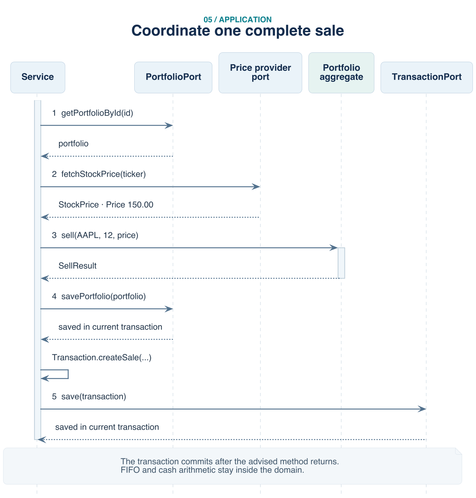
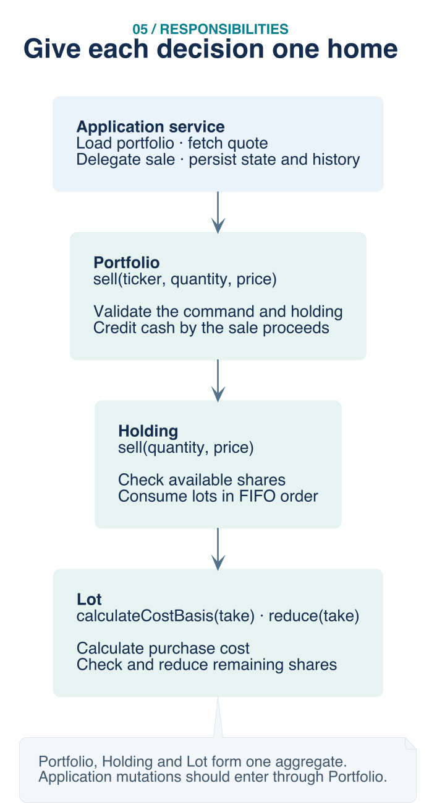

# 5. Coordinate the use case

**Goal:** Separate application orchestration from domain decisions.

**Study time:** 10–15 minutes, including the checkpoint. **Before starting:** complete [Stage 4](SELL-STOCK-04-HTTP-AND-PORTS.md).

## Read the use-case contract

The sell member of [PortfolioStockOperationsUseCase.java](https://github.com/alfredorueda/HexaStock/blob/main/application/src/main/java/cat/gencat/agaur/hexastock/application/port/in/PortfolioStockOperationsUseCase.java) is:

```java
SellResult sellStock(PortfolioId portfolioId, Ticker ticker, ShareQuantity quantity);
```

The contract names the operation using domain types. Its implementation, [PortfolioStockOperationsService.java](https://github.com/alfredorueda/HexaStock/blob/main/application/src/main/java/cat/gencat/agaur/hexastock/application/service/PortfolioStockOperationsService.java), coordinates three outbound ports:

| Port | What the use case needs |
| --- | --- |
| `PortfolioPort` | Retrieve and persist portfolio state |
| `StockPriceProviderPort` | Fetch a quote containing a `Price` |
| `TransactionPort` | Persist a separate transaction record |

## Follow the actual service method

The class has `jakarta.transaction.Transactional`; the method also has the application's `@RetryOnWriteConflict` marker. Their infrastructure behaviour is the subject of [Stage 7](SELL-STOCK-07-CONSISTENCY.md).

```java
@Override
@RetryOnWriteConflict
public SellResult sellStock(PortfolioId portfolioId, Ticker ticker, ShareQuantity quantity) {
    Portfolio portfolio = portfolioPort.getPortfolioById(portfolioId)
            .orElseThrow(() -> new PortfolioNotFoundException(portfolioId.value()));

    StockPrice stockPrice = stockPriceProviderPort.fetchStockPrice(ticker);
    Price price = stockPrice.price();

    SellResult sellResult = portfolio.sell(ticker, quantity, price);
    portfolioPort.savePortfolio(portfolio);

    Transaction transaction = Transaction.createSale(
            portfolioId, ticker, quantity, price, sellResult.proceeds(), sellResult.profit());
    transactionPort.save(transaction);

    return sellResult;
}
```

The service decides how to coordinate a use case, including what to do when a portfolio is missing. It does not calculate FIFO cost basis, choose individual lots or adjust the balance itself. Those business decisions belong to the domain.



[Open the scalable diagram](https://github.com/alfredorueda/HexaStock/blob/main/doc/tutorial/sellStocks/diagrams/Rendered/sell-application-service.svg) · [PlantUML source](https://github.com/alfredorueda/HexaStock/blob/main/doc/tutorial/sellStocks/diagrams/sell-application-service.puml)

## Keep orchestration out of the algorithm

A tempting shortcut is to loop over `portfolio.getHolding(ticker).getLots()` inside the service, call `lot.reduce(...)`, then call `portfolio.deposit(...)`. This duplicates the FIFO rule and separates inventory mutation from the balance update it must accompany. The service could credit the requested quantity even if the loop consumed fewer shares.

The intended operation is the single call `portfolio.sell(ticker, quantity, price)`. It keeps that relationship in one domain operation. Direct entity mutation is technically possible, as [Stage 3](SELL-STOCK-03-FIFO.md) explained; the architecture must be followed rather than assumed to enforce itself.



[Open the scalable diagram](https://github.com/alfredorueda/HexaStock/blob/main/doc/tutorial/sellStocks/diagrams/Rendered/sell-orchestrator-vs-aggregate.svg) · [PlantUML source](https://github.com/alfredorueda/HexaStock/blob/main/doc/tutorial/sellStocks/diagrams/sell-orchestrator-vs-aggregate.puml)

## Distinguish an outcome from a historical record

`SellResult` is an immutable value returned to the caller. `Transaction.createSale(...)` creates a separate historical entity, which the service saves through `TransactionPort`. They serve different purposes and have different lifecycles.

The current flow records the sale directly. A future domain-event design could decouple other reactions, but an in-memory domain event alone would not guarantee atomic delivery to external services. That would require an explicit delivery and consistency design.

**Wiring:** [SpringAppConfig.java](https://github.com/alfredorueda/HexaStock/blob/main/bootstrap/src/main/java/cat/gencat/agaur/hexastock/config/SpringAppConfig.java) creates the service bean and injects the selected port implementations.

## Checkpoint

If `transactionPort.save(...)` fails after `savePortfolio(...)` returns, is the sale safely complete? Identify the domain responsibility and the infrastructure responsibility.

**Check your answer:** The domain has calculated and applied the in-memory sale, but completion depends on the surrounding transaction. The persistence writes must commit together or roll back together; a successful repository method return alone does not mean commit.

**Stop here** when you can explain the answer without looking at the code. You can resume at the next stage later.

---

[Previous](SELL-STOCK-04-HTTP-AND-PORTS.md) · [Learning path](SELL-STOCK-TUTORIAL.md) · [Next: Stage 6](SELL-STOCK-06-PERSISTENCE.md)
