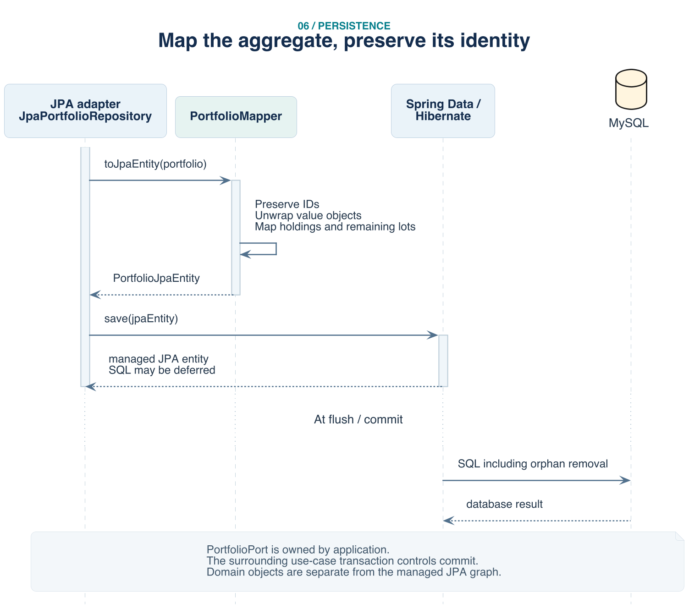

# 6. Save and reload the aggregate

**Goal:** Explain mapping, identity, FIFO order and query costs.

**Study time:** 15–20 minutes, including the checkpoint. **Before starting:** complete [Stage 5](SELL-STOCK-05-ORCHESTRATION.md).

## Follow the JPA adapter

`PortfolioPort` belongs to the **application module**, not the domain module. [JpaPortfolioRepository.java](https://github.com/alfredorueda/HexaStock/blob/main/adapters-outbound-persistence-jpa/src/main/java/cat/gencat/agaur/hexastock/adapter/out/persistence/jpa/repository/JpaPortfolioRepository.java) implements it and delegates database operations to `JpaPortfolioSpringDataRepository`.

The save method is short:

```java
public void savePortfolio(Portfolio portfolio) {
    PortfolioJpaEntity jpaEntity = PortfolioMapper.toJpaEntity(portfolio);
    jpaSpringDataRepository.save(jpaEntity);
}
```

The adapter maps the domain object into a separate JPA object graph. Domain classes are not Hibernate entities and do not become dirty-tracked just because they were loaded through a repository.



[Open the scalable diagram](https://github.com/alfredorueda/HexaStock/blob/main/doc/tutorial/sellStocks/diagrams/Rendered/sell-persistence-adapter.svg) · [PlantUML source](https://github.com/alfredorueda/HexaStock/blob/main/doc/tutorial/sellStocks/diagrams/sell-persistence-adapter.puml)

## Preserve meaning across the boundary

| Domain | JPA representation |
| --- | --- |
| `PortfolioId` | `PortfolioJpaEntity.id`, a `String` |
| `Money` balance | `PortfolioJpaEntity.balance`, a `BigDecimal` |
| Holdings indexed by `Ticker` | Collection of `HoldingJpaEntity` |
| `LotId`, quantities and `Price` | `LotJpaEntity` identity and scalar fields |

Loading reverses this translation. The implementation in [PortfolioMapper.java](https://github.com/alfredorueda/HexaStock/blob/main/adapters-outbound-persistence-jpa/src/main/java/cat/gencat/agaur/hexastock/adapter/out/persistence/jpa/mapper/PortfolioMapper.java) reconstructs the aggregate:

```java
public static Portfolio toModelEntity(PortfolioJpaEntity jpaEntity) {
    Portfolio portfolio = new Portfolio(
            PortfolioId.of(jpaEntity.getId()),
            jpaEntity.getOwnerName(),
            Money.of(jpaEntity.getBalance()),
            jpaEntity.getCreatedAt()
    );
    for (var holdingJpaEntity : jpaEntity.getHoldings()) {
        portfolio.addHolding(HoldingMapper.toModelEntity(holdingJpaEntity));
    }
    return portfolio;
}
```

`HoldingMapper` reconstructs lots through `addLotFromPersistence(...)`, which restores chronological order. Identity values must survive the round trip: a loaded lot represents the same purchase batch, not a new purchase.

The JPA collections use `cascade = ALL` and `orphanRemoval = true`. When the saved graph no longer contains a depleted lot, Hibernate can delete that orphan. SQL may execute during flush or commit; `save(...)` is not itself the transaction boundary.

## Understand loading cost without guessing guarantees

Reconstruction visits every holding and every lot. With lazy collections and no batching, a cold load can require one portfolio query, one holdings query and one lots query per holding: **2 + H** for **H** holdings.

Both collections declare `@BatchSize(size = 30)`. Hibernate can load several uninitialized collections of the same role together, reducing round trips. A useful teaching estimate is **2 + ceil(H / 30)** when all relevant collections are available for batching. This is **not a guaranteed SQL count**: persistence-context contents, cache state and fetch behaviour affect the queries actually issued. Measure SQL for the workload before asserting a bound. See the [Hibernate batch-fetching documentation](https://docs.hibernate.org/orm/6.6/userguide/html_single/#fetching-batch).

Fetching the nested chain portfolio → holdings → lots with a join repeats parent columns for each lot. It does not create every possible holding–lot combination: each lot belongs to one holding. A true Cartesian multiplication is a particular risk when independently fetching multiple sibling collections. Join fetching and batching have different trade-offs; neither is universally best.

## Recognize the alternative adapter

The `mongodb` profile selects `MongoPortfolioRepository` and `MongoTransactionRepository`. It stores holdings and lots inside a portfolio document, while history remains in separate transaction documents. The application still uses the same ports and domain objects.

This substitution changes storage, mapping and concurrency mechanisms. It does not automatically guarantee equivalent behaviour; shared port contract tests and integration tests provide evidence for that equivalence.

## Checkpoint

After selling 12 shares, list the state that must survive save and reload. Explain why testing only the mapper would be insufficient.

**Check your answer:** Cash must include **1800.00** proceeds; Lot 1 must be absent; Lot 2 must keep its identity, price **120.00** and **3 remaining shares**. A mapper-only test cannot verify cascade/orphan removal, SQL ordering, transaction boundaries or database concurrency.

**Stop here** when you can explain the answer without looking at the code. You can resume at the next stage later.

---

[Previous](SELL-STOCK-05-ORCHESTRATION.md) · [Learning path](SELL-STOCK-TUTORIAL.md) · [Next: Stage 7](SELL-STOCK-07-CONSISTENCY.md)
