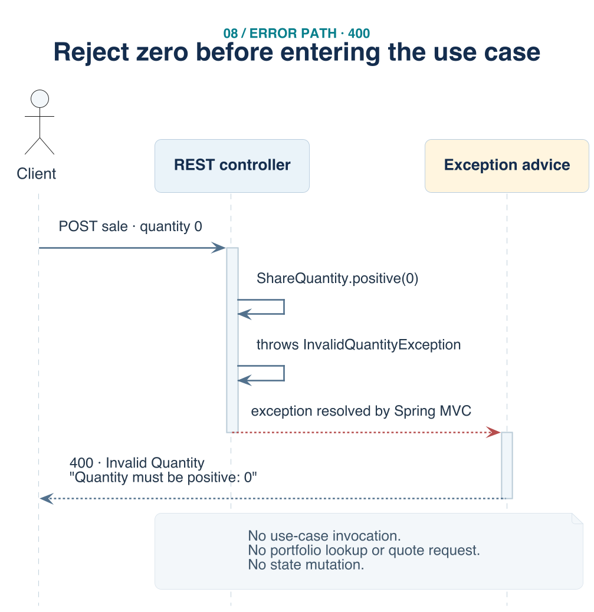
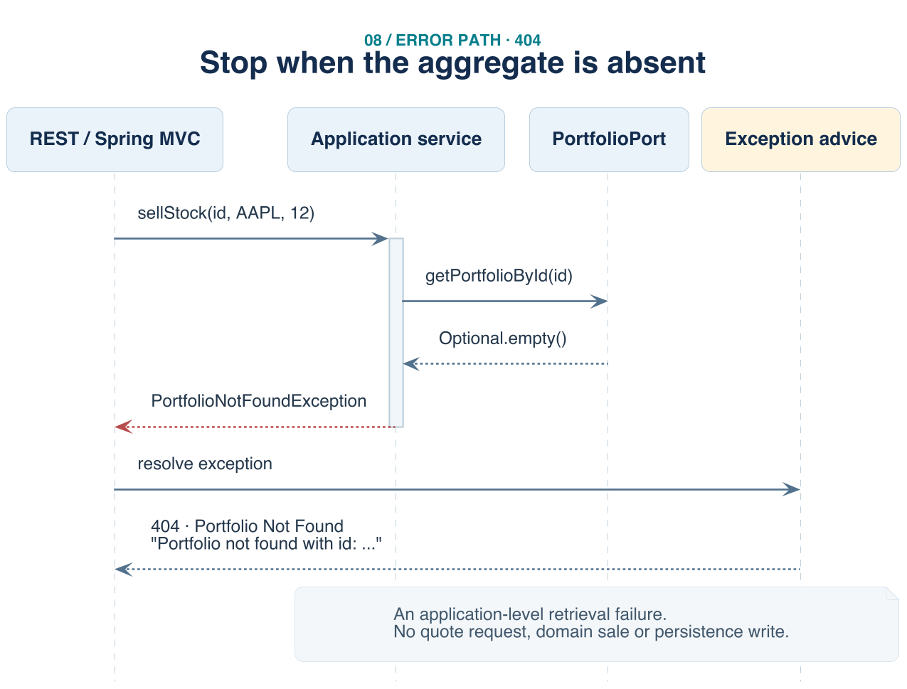
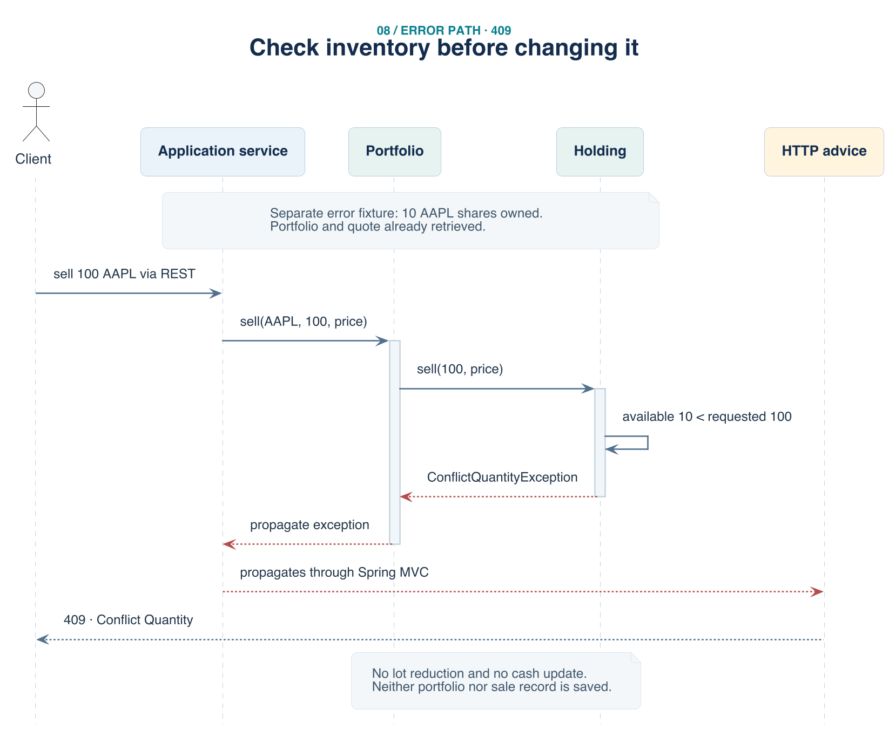

# 8. Trace failures

**Goal:** Locate each failure and explain its HTTP response.

**Study time:** 10–15 minutes, including the checkpoint. **Before starting:** complete [Stage 7](SELL-STOCK-07-CONSISTENCY.md).

## Follow the first failing boundary

Error order matters. The controller constructs value objects first; the service loads the portfolio, fetches a price, then invokes the aggregate. A failure stops that path at its origin.

[ExceptionHandlingAdvice.java](https://github.com/alfredorueda/HexaStock/blob/main/adapters-inbound-rest/src/main/java/cat/gencat/agaur/hexastock/adapter/in/ExceptionHandlingAdvice.java) maps named exceptions into Spring `ProblemDetail` responses:

| Condition | Origin | Exception | HTTP / title |
| --- | --- | --- | --- |
| Zero or negative quantity | `ShareQuantity.positive(...)` in controller | `InvalidQuantityException` | 400 / Invalid Quantity |
| Invalid ticker format | `Ticker.of(...)` in controller | `InvalidTickerException` | 400 / Invalid Ticker |
| Missing portfolio | Application service lookup | `PortfolioNotFoundException` | 404 / Portfolio Not Found |
| Ticker absent from portfolio | `Portfolio.sell(...)` | `HoldingNotFoundException` | 404 / Holding Not Found |
| Not enough shares | `Holding.sell(...)` | `ConflictQuantityException` | 409 / Conflict Quantity |
| Provider failure wrapped in `ExternalApiException` | Market adapter | `ExternalApiException` | 503 / External API Error |

A missing portfolio is an **application exception**, not a domain exception. The service cannot invoke an aggregate that was not retrieved. A missing holding and insufficient shares are business failures evaluated inside an existing aggregate.

## Invalid quantity: stop before orchestration

`ShareQuantity.positive(0)` throws with detail `Quantity must be positive: 0`. No repository or price-provider call is needed. The root's additional zero check protects non-HTTP callers; it is not reached for this HTTP request.



[Open the scalable diagram](https://raw.githubusercontent.com/alfredorueda/HexaStock/main/doc/tutorial/sellStocks/diagrams/Rendered/sell-error-invalid-quantity.svg) · [PlantUML source](https://github.com/alfredorueda/HexaStock/blob/main/doc/tutorial/sellStocks/diagrams/sell-error-invalid-quantity.puml)

## Missing portfolio: stop before the provider

The lookup returns `Optional.empty()`, and the service throws `PortfolioNotFoundException`. The exception constructor formats the detail as `Portfolio not found with id: <id>`. There is no price lookup, domain sale or save.



[Open the scalable diagram](https://raw.githubusercontent.com/alfredorueda/HexaStock/main/doc/tutorial/sellStocks/diagrams/Rendered/sell-error-portfolio-not-found.svg) · [PlantUML source](https://github.com/alfredorueda/HexaStock/blob/main/doc/tutorial/sellStocks/diagrams/sell-error-portfolio-not-found.puml)

## Overselling: stop before mutation

For an independent error example, assume the portfolio owns **10 AAPL shares** and the request sells **100**. Once a quote has been obtained, `Holding.sell(...)` rejects the request before touching lots. HTTP status is **409 Conflict**. These are the relevant fields in the problem body; Spring can also supply `type` and `instance`:

```json
{
  "title": "Conflict Quantity",
  "detail": "Not enough shares to sell. Available: 10, Requested: 100",
  "status": 409
}
```



[Open the scalable diagram](https://raw.githubusercontent.com/alfredorueda/HexaStock/main/doc/tutorial/sellStocks/diagrams/Rendered/sell-error-sell-more-than-owned.svg) · [PlantUML source](https://github.com/alfredorueda/HexaStock/blob/main/doc/tutorial/sellStocks/diagrams/sell-error-sell-more-than-owned.puml)

The integration test `sellMoreThanOwned_returns409` in `PortfolioTradingRestIntegrationTest` uses its own smaller fixture: it buys 5 shares and requests 10. The numerical fixture differs, but the same exception and HTTP contract are exercised.

## Keep the error contract precise

The advice maps `ExternalApiException` specifically to **503**, not a generic “502 or 503”. Other unexpected exceptions do not automatically receive this mapping. Malformed JSON is handled by Spring's HTTP infrastructure, separately from the domain-specific handlers above.

Because the provider is called before `Portfolio.sell(...)`, a provider failure can occur before a missing-holding or insufficient-shares error is detected. The documentation should describe that order rather than imply every business rejection avoids external I/O.

Problem responses identify failures; rollback and concurrency safety still depend on [Stage 7](SELL-STOCK-07-CONSISTENCY.md).

## Checkpoint

For a valid request with both a missing portfolio and an unavailable provider, which error is reached? Repeat the reasoning for an existing portfolio with too few shares and an unavailable provider.

**Check your answer:** A missing portfolio produces **404** before any provider call. For an existing portfolio, the provider is called before the inventory check; if it throws `ExternalApiException`, the response is **503**, even though the shares would also be insufficient.

**Stop here** when you can explain the answer without looking at the code. You can resume at the next stage later.

---

[Previous](SELL-STOCK-07-CONSISTENCY.md) · [Learning path](SELL-STOCK-TUTORIAL.md) · [Next: Stage 9](SELL-STOCK-09-VERIFICATION.md)
