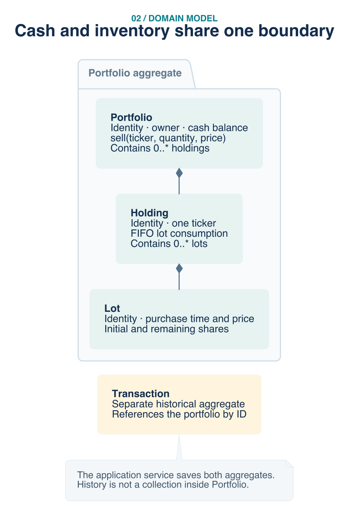

# Sell Stock: The Domain-Only Learning Path

Learn the sale rules in three short sessions, using plain Java objects and JUnit. No database, web server or API key is needed.

**Prerequisites:** Java classes, interfaces and basic assertions. If the business terms are new, read the [shared vocabulary](UBIQUITOUS-LANGUAGE.md) first.

## 1. Calculate the expected behavior

Read [Stage 1: specify the sale](SELL-STOCK-01-BEHAVIOUR.md). Work through the example with two purchase lots and a sale of 12 shares.

Before continuing, explain why cash increases by 1800.00 while profit is only 560.00. These values describe different things: proceeds and proceeds minus historical cost.

## 2. Test through the aggregate root

Read [Stage 2: model and test the aggregate](SELL-STOCK-02-DOMAIN-TEST.md), then run:

```bash
./mvnw -pl domain test
```

`Portfolio` is the aggregate root. `Holding` and `Lot` are child entities. The aggregate-level test checks the sale result and the cash update together; a holding-level test can check FIFO without observing portfolio cash.

A successful unit test demonstrates the assertions made for its inputs. It does not establish database atomicity, concurrent-request safety or that every public mutation path preserves every invariant.

## 3. Trace the FIFO loop

Read [Stage 3: follow the FIFO algorithm](SELL-STOCK-03-FIFO.md). Use the diagram to predict the remaining quantity after each iteration, then compare your prediction with the code.



Depleted lots are removed during the loop. The empty holding itself remains in the portfolio after a complete sale. Rehydration inserts lots by purchase time; equal timestamps do not have an explicit secondary ordering rule.

**Stop here for a first lesson.** You can explain and test the business operation without studying HTTP or persistence. When ready, [Stage 4](SELL-STOCK-04-HTTP-AND-PORTS.md) connects this model to the rest of the application.

## Practice at increasing difficulty

### Trace a purchase

Write a short trace of `Portfolio.buy`: validation, lot creation and the cash change. Compare it with a sale. Explain why buying creates a lot while selling may consume several lots.

### Explain identity and value

Why is `Lot` an entity while `Ticker` is a value object? Why is `PortfolioId` a value object even though it represents identity? Use equality and state changes in your answer.

### Examine the boundary

Explain what could go wrong if a caller invokes `Holding.sell` directly and forgets to update portfolio cash. The current model exposes mutable children, so this bypass is possible. Explain the intended root-based update path and propose a way to reduce accidental bypasses.

### Extend the rules: maximum sale percentage

This is an **exercise**, not a rule of the current application:

- Positive sales of at most 10 shares have no additional percentage restriction.
- A sale of more than 10 shares may consume at most 50% of the holding.
- Existing availability checks still apply.

Choose a place for the rule, justify the choice and add an `ExcessiveSaleException`. Test a holding of 30 shares: selling 10 succeeds, selling 15 succeeds, and selling 16 fails without changing cash or lots. Also test an insufficient-shares request and zero quantity.

For each test, start from a fresh portfolio. Do not let an earlier sale change the preconditions of the next example.

## Further study

- [Application orchestration](SELL-STOCK-05-ORCHESTRATION.md): why the service loads, delegates and saves.
- [Persistence](SELL-STOCK-06-PERSISTENCE.md): how plain Java state is mapped to storage.
- [Consistency](SELL-STOCK-07-CONSISTENCY.md): what transactions and concurrency control add.
- [Additional exercises](SELL-STOCK-EXERCISES.md): extend the learning path.

## References

* Evans, Eric. _Domain-Driven Design: Tackling Complexity in the Heart of Software._ Addison-Wesley, 2003.
* Fowler, Martin. "AnemicDomainModel." _martinfowler.com_, 2003. https://martinfowler.com/bliki/AnemicDomainModel.html
* Fowler, Martin. _Refactoring: Improving the Design of Existing Code._ 2nd ed., Addison-Wesley, 2018. (Primitive Obsession code smell.)
* North, Dan. "Introducing BDD." _Better Software_, March 2006. https://dannorth.net/introducing-bdd/
* Vernon, Vaughn. _Implementing Domain-Driven Design._ Addison-Wesley, 2013.
