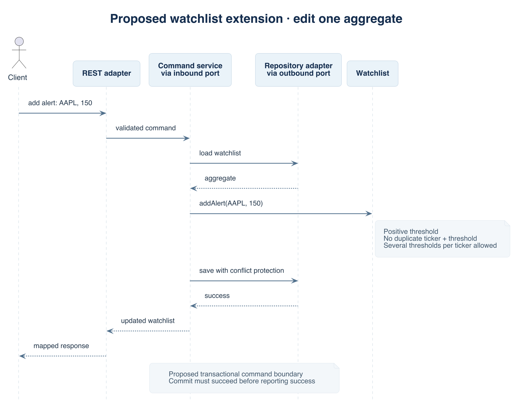

# 1. Model watchlist commands

**Goal:** protect a watchlist's rules without Spring or a database. This is a proposed extension, not current `main` behavior.

A watchlist is a named collection of alert conditions. Each threshold alert matches when an observed price is **less than or equal to** its threshold. For AAPL thresholds 150, 140, and 130, a price of 145 matches only 150; a price of 128 matches all three.

## Define the model

| Proposed type | Responsibility |
|---|---|
| `WatchlistId` | Identity of one watchlist |
| `Watchlist` | Aggregate with ID, owner name, list name, active flag, and alerts |
| `AlertEntry` | Immutable ticker and positive threshold amount |

Reuse the existing `Ticker` and `Money` value objects. `Money` permits negative values in other contexts, so the alert must explicitly reject non-positive thresholds after normalization. The exercise assumes a single currency. Owner name is a teaching label, not an authenticated identity.

Use a `List<AlertEntry>` to preserve insertion order and allow several thresholds for a ticker. A `Map<Ticker, AlertEntry>` would allow only one alert per ticker, but a map to a collection or an ordered set could also model this requirement. The domain rule, not a universally preferred collection, determines the choice.

For Level 1, duplicate means the same normalized ticker and monetary threshold. A record's generated equality can express that while those are its only fields. Return an immutable copy or unmodifiable view and state which you chose: a view reflects later internal edits, a copy does not. Neither makes mutable elements immutable; here alert elements should themselves be immutable.

## Required commands

| Command | Contract |
|---|---|
| Create | Nonblank owner and list name; generated ID; active; no alerts |
| Delete | Watchlist must exist |
| Add alert | Existing watchlist; positive threshold; reject exact duplicate |
| Remove one alert | Match ticker and threshold; reject absent alert |
| Remove all for ticker | Reject when no alert has that ticker |
| Activate/deactivate | Existing watchlist; repeating the desired state succeeds |

Write these domain tests before persistence work: invalid names, zero/negative threshold, exact duplicate, same ticker at different thresholds, removal of one without removing the others, removal of all for one ticker, and activation transitions. Verify rejected operations leave state unchanged.

An application service loads the aggregate, invokes its behavior, and saves through a proposed `WatchlistRepositoryPort`. A REST adapter calls an inbound use-case interface. Bootstrap configuration wires the service, following [ADR-015](../../architecture/adr/ADR-015-explicit-bean-wiring-via-configuration.md). Define the HTTP contract and error mapping in your assignment before exposing endpoints; no watchlist routes exist in the baseline OpenAPI.

[Open the full-size diagram (SVG)](https://raw.githubusercontent.com/alfredorueda/HexaStock/main/doc/tutorial/watchlists/diagrams/Rendered/watchlist-command-flow.svg)

**Checkpoint:** adding AAPL at 150 twice fails; adding it at 140 succeeds. Explain why using ticker alone as the uniqueness key would violate that contract.

Next: [detect matches through ports](02-DETECTION-AND-PORTS.md).
