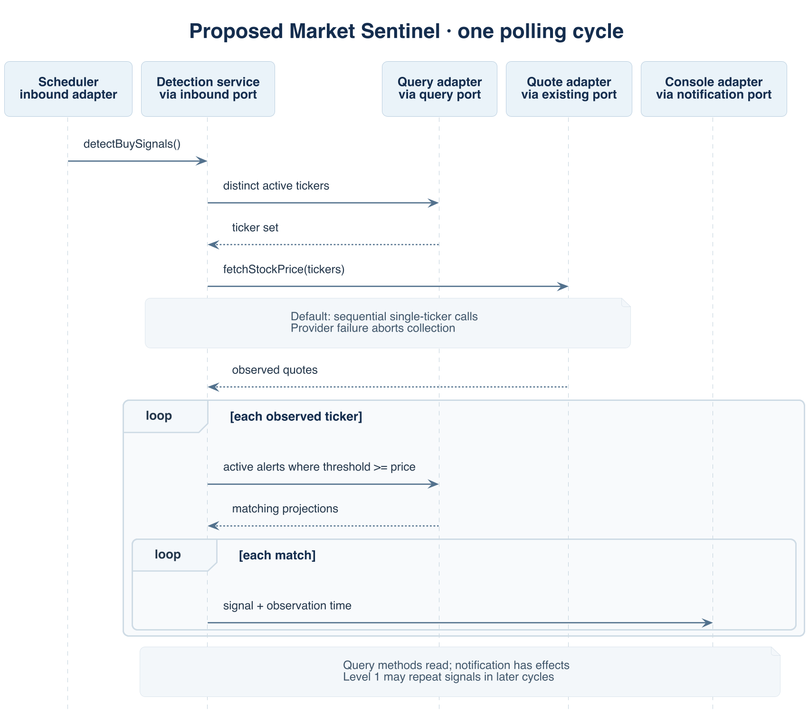

# 2. Detect threshold matches through ports

**Goal:** implement and test one polling cycle with deterministic quotes. All watchlist-specific types below are proposed.

## Separate queries from effects

The detection service coordinates three capabilities:

| Outbound port | Responsibility |
|---|---|
| Proposed `WatchlistQueryPort` | Distinct active tickers and matching alert projections |
| Existing `StockPriceProviderPort` | Observed stock prices |
| Proposed `NotificationPort` | Deliver a signal to a console adapter in Level 1 |

A scheduler is an inbound adapter calling a proposed `MarketSentinelUseCase`. Keep Spring scheduling annotations in the adapter and construct the application service through bootstrap configuration.

The query methods read data without loading full aggregates. **The complete detection use case has effects:** it sends notifications. Calling it a pure query would obscure those effects, even before introducing persisted delivery state.

## One Level 1 cycle

1. Find distinct tickers in active watchlists. Stop if none exist.
2. Fetch one quote per distinct ticker through the existing provider port.
3. For each quote, query active alerts with `threshold_price >= currentPrice`.
4. Create a signal containing the watchlist identity, owner/list labels, ticker, threshold, observed price, and observation time.
5. Send each signal to the console adapter.

The existing `fetchStockPrice(Set<Ticker>)` method performs sequential single-ticker calls by default. It is **not one remote batch request**. An exception aborts collection; the default method does not return a partial map of successful quotes. For Level 1, test and document this fail-fast behavior. Partial success requires a deliberate new contract and tests, not silent assumptions.

Place projection and signal transport records with application contracts. If `BuySignal.from(TriggeredAlertView, StockPrice)` is used, keeping both application-owned avoids making the domain depend on an application projection. Validate matching tickers and required values in a constructor or validated factory with controlled construction paths; a public record constructor remains callable even when a static factory exists.

`StockPrice` exposes `ticker()`, `price()`, and `time()` (`Instant`). It has no previous-close field. Real-provider caching can return an older observation. Decide what age is acceptable before treating the result as current; a one-minute polling interval does not imply one-minute quote freshness.

[Open the full-size diagram (SVG)](https://raw.githubusercontent.com/alfredorueda/HexaStock/main/doc/tutorial/watchlists/diagrams/Rendered/market-sentinel-detection-flow.svg)

## A deterministic service test

Use active AAPL alerts at 150, 140, and 130 and an inactive watchlist containing GOOGL. Return AAPL at 145 from a fake provider. Assert that:

* Only AAPL is requested, once for the cycle.
* The query receives the observed price 145.
* Exactly the 150 alert is notified, with the correct ticker and observation time.
* A second cycle can produce the same notification: Level 1 is condition matching, not threshold-crossing detection.
* A provider exception prevents notification in this fail-fast cycle.

Also test equality at the threshold, no active alerts, all thresholds matched, and notification failure. In the simple synchronous loop, an uncaught notification exception stops the remaining cycle, not merely the current ticker.

**Checkpoint:** a quote was below the threshold between polls but above it at both observations. The polling design cannot guarantee detection of that transient match.

Next: [persist and verify](03-PERSISTENCE-AND-TESTS.md).
