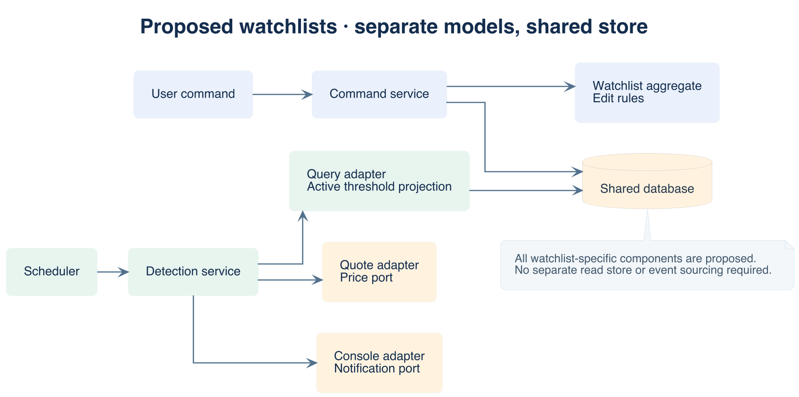

# 3. Persist and verify the proposed extension

**Goal:** implement the write mapping and query projection against one database, then verify their shared semantics.

## Choose explicit persistence identities

A relational proposal has a `watchlist` table and child `alert_entry` rows. The watchlist ID and child foreign key must have compatible types: if the domain uses UUID text, do not silently declare a numeric foreign key in the diagram or DDL. A generated numeric child-row ID is independent of that decision.

Persist ticker as text and threshold as a suitably sized decimal. `Ticker` is a value object; it does not require a JPA entity or many-to-many mapping. Consider a unique constraint on `(watchlist_id, ticker, threshold_price)` as a second line of defense. Aggregate checks alone do not coordinate simultaneous edits: choose optimistic versioning or a cooperating lock protocol and test a conflict.

These illustrative SQL queries assume the proposed schema; they are not existing repository queries:

```sql
SELECT DISTINCT e.ticker
FROM alert_entry e
JOIN watchlist w ON w.id = e.watchlist_id
WHERE w.active = true;
```

```sql
SELECT w.id, w.owner_name, w.list_name, e.id AS alert_id,
       e.ticker, e.threshold_price
FROM alert_entry e
JOIN watchlist w ON w.id = e.watchlist_id
WHERE w.active = true
  AND e.ticker = :ticker
  AND e.threshold_price >= :currentPrice;
```

The second query repeats the active check because a watchlist can change after ticker discovery. It still does not prevent deactivation between selection and delivery. Define the required observation point rather than promising a globally consistent cycle.

Indexes belong to tables: `active` and `ticker` are in different tables here, so a single ordinary index on `(active, ticker)` cannot cover both. Evaluate candidate indexes on each table with actual query plans and representative data.

## Verify the adapter contract

| Check | Evidence |
|---|---|
| Round trip | Identity, names, state, and all alert values survive save/reload |
| Duplicate protection | Same normalized pair rejected, including concurrent edits |
| Active filtering | Inactive alerts excluded in both queries |
| Threshold boundary | At 145, only 150 matches among 150/140/130; equality matches |
| Projection identity | Distinct alerts remain distinguishable when owner labels coincide |
| Mapping consistency | Domain and SQL agree on normalization and decimal precision |
| Error behavior | Missing watchlist and database failures follow the chosen port contract |

A MongoDB implementation is optional. It must pass equivalent contracts; an existing portfolio adapter does not imply a watchlist query adapter already exists. Projection mechanics, document size, and versioning need their own design.



## Measure before scaling

Let T be distinct tickers and R the matching alerts. An unpaged cycle uses approximately 1 + T database queries, T single-ticker provider method calls by default, and R notification calls. Cache hits can reduce remote calls. Index scans and joins have their own costs; counting round trips is not a full complexity analysis.

The all-ticker set and quote map use memory proportional to T; each returned match list can contain many alerts. No page boundary exists unless you implement one. Measure worst-case matches as well as typical traffic. Use pagination/chunking, bounded dispatch, or query redesign when the measured requirement justifies them.

**Checkpoint:** propose a test where every alert matches. Explain what becomes the memory or latency bottleneck in your implementation.

Next: [choose one extension](04-PROGRESSIVE-EXTENSIONS.md).
